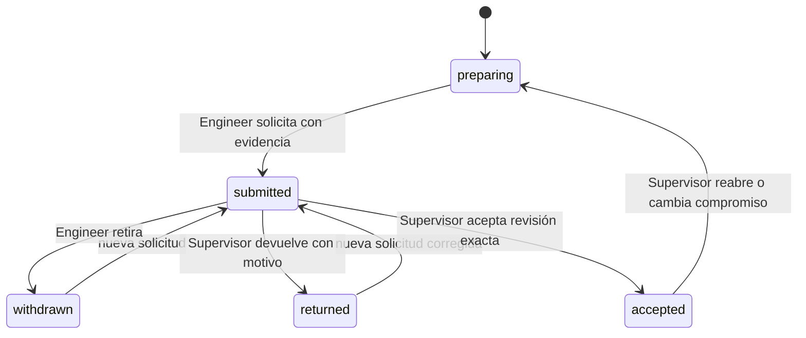

# Contrato de planeación por resultados

Fuente estructural: [project_results.schema.json](project_results.schema.json).
Reglas de producto: [catálogo](../../docs/product/catalogo-modulos.md#planeación-por-entregables-y-cierre-verificable).
Aceptación y estado de desarrollo: [R1–R7](../../docs/product/plan-maestro.md#evolución-hacia-planeación-y-cierre-por-resultados).

## Frontera y compatibilidad

El [contrato de operaciones](project_results_operations.schema.json) define las
entradas/respuestas y el [contrato de almacenamiento](project_results_storage.schema.json)
define manifiestos y revisiones. `version: 1` es la versión del dominio. La
activación explícita de cada proyecto selecciona su almacenamiento nuevo; no se
deduce de porcentajes ni de aprobaciones históricas. Credenciales permanecen en
sus particiones actuales.

`project_results_capabilities({projectId})` es una consulta sin efectos secundarios.
Devuelve `$defs/capabilities`; errores son cadenas. Rust deriva espacio e identidad
de la sesión normal revalidada y comprueba visibilidad del proyecto. No recibe
rutas ni identidades. Informa la política del dominio nuevo, no disponibilidad de
comandos para una sesión distinta o una revisión posterior. No autoriza por sí sola
ninguna escritura: cada operación revalida sesión, asignación y revisión al publicar.

`results_detail({projectId})` devuelve `$defs/detail` de operaciones. Las escrituras
reciben `{input}`: `results_save_commitment`, `results_save_activity`,
`results_save_blocker`, `results_review`, `results_set_closure`, `results_resolve`
y `results_attach_evidence`, con sus entradas homónimas en el esquema.
`results_read_evidence({projectId,evidenceId})` devuelve bytes verificados. Todas
las mutaciones devuelven el detalle actualizado. Errores son cadenas; una revisión
obsoleta no se convierte en guardado exitoso ni se reintenta sobre datos nuevos.

| Operación de dominio | Engineer asignado | Supervisor único activo | Admin |
|---|---|---|---|
| Consultar proyecto autorizado | Sí | Sí | Sí |
| Planear y actualizar actividades compartidas; reportar bloqueo | Sí | Consulta | Consulta |
| Solicitar o retirar revisión de entregable | Sí | Consulta | Consulta |
| Cambiar compromiso, reabrir aceptación o resolver conflicto concurrente | No | Sí | No |
| Aceptar/devolver entregable; resolver bloqueo | No | Sí | No |

El Supervisor puede registrar atención y resolución sin convertirse en editor
cotidiano de actividades. Si hay más de un Supervisor activo, las capacidades de
autoridad son falsas. Una sesión restringida, revocada o no asignada no obtiene
acceso de Engineer al proyecto. Un responsable de actividad no reemplaza ni amplía
la asignación al proyecto.

## Relaciones y fechas

- Un proyecto tiene un compromiso con uno o más entregables; cada entregable tiene
  uno o más criterios identificados. Un ID de criterio es único dentro de su entregable.
- Cada actividad pertenece a un entregable y tiene un responsable entre los
  ingenieros asignados. Esto no concede responsabilidad exclusiva ni impide la
  colaboración autorizada; autor y editores se registran en las revisiones de R2.
- Fechas del compromiso y entregables son fechas civiles `YYYY-MM-DD`; inicio ≤
  fecha de entregable ≤ fecha objetivo del proyecto. Las previsiones de actividad
  pueden exceder el compromiso para hacer visible el retraso sin mover la referencia.
- Primera versión: dependencias fin–inicio dentro del proyecto, sin lag ni
  reprogramación automática. Inicio previsto de sucesora ≥ fin de predecesora;
  rechazar referencias inexistentes, propias, duplicadas y ciclos incluso con
  duración cero. Las actividades sin dependencias permanecen independientes.
- Estados de actividad: `not_started`, `in_progress`, `done`. Captura de avance en
  0/25/50/75/100. `not_started` exige 0 y horas nulas/cero; `done` exige 100;
  `in_progress` permite 0 mientras se prepara trabajo, pero nunca 100. `at_risk`
  es independiente. No existe estado de actividad «aprobada» en este dominio.
- `hours_spent` es acumulado no negativo o null (desconocido). Nota y horas son
  campos presentes y anulables; no volver a pedir datos del plan para actualizar.

## Revisiones, evidencia y cierre

Rust genera las identidades de revisiones y solicitudes; 64 hex minúsculas. Los IDs
de proyecto se conservan; IDs nuevos de entregable/actividad/criterio admiten letras
ASCII, números, guion y guion bajo. Los IDs nunca son rutas recibidas del cliente.

El primer compromiso fija la referencia para seguimiento. Cada cambio crea una revisión
nueva y conserva la anterior con motivo, autor y fecha. El Supervisor confirma esa
referencia al activar el proyecto; reprogramar no reemplaza la referencia
histórica para reportar cumplimiento. El contrato no concede al cliente la facultad
de declarar vigente una revisión ni de presentar una firma como verificada.

Una solicitud identifica entregable, revisión exacta del compromiso y cada criterio
cumplido una sola vez. Cada criterio que requiere evidencia debe referir al menos
un adjunto autorizado y verificado. Los IDs de evidencia referencian adjuntos
inmutables existentes; no duplicar bytes o metadatos en la solicitud. Evidencia
opcional no equivale a criterio opcional: todos los criterios deben cumplirse.

Las solicitudes son inmutables. Retirar una solicitud pendiente la pasa a `withdrawn`;
corregir o volver a solicitar crea otra identidad. Devolver requiere motivo. Una
aceptación vincula proyecto, entregable, solicitud, revisión del compromiso y firma
del Supervisor. La forma de `signature` no prueba autenticidad: Rust verifica firma,
integridad, vigencia, transición y referencias antes de publicar.



Regla conservadora inicial: cualquier cambio de compromiso requiere nueva aceptación
de sus entregables; mantiene decisiones anteriores como historia. Editar una nota,
previsión o avance de actividad no reescribe solicitudes o evidencias inmutables ni
invalida por sí mismo una aceptación. Cambiar el resultado o la evidencia que se
pretende aceptar requiere una nueva solicitud; después de aceptación, el Supervisor
debe reabrir. Los eventos conservan estas acciones, sin marcar terminado un
proyecto por lectura ni por porcentaje. Reabrir un proyecto cerrado requiere acción
explícita del Supervisor y nueva revisión del estado de cierre, conservando el cierre
anterior; un cambio posterior de compromiso exige nueva aceptación.

La precondición de cierre comprueba todos los entregables, decisiones vigentes y
sin conflicto, evidencias verificadas y estado final validado por Supervisor. El
validador puro no autentica firmas ni cambia el estado persistido: Rust verifica
las decisiones y evidencias. `confirm_final_outcome` es una declaración explícita
del Supervisor autorizado que queda dentro de la revisión de cierre firmada; un
booleano enviado por Engineer no concede cierre ni aceptación.

## Bloqueos

El bloqueo referencia una actividad y registra impedimento, ayuda requerida y fecha
de reporte. Primera atención es independiente de resolución: un comentario no
desbloquea. Resolver exige fecha, atención previa o simultánea y nota de resolución;
las fechas son RFC3339 con offset y no retroceden. Puede atenderse y resolverse en
una sola operación. El bloqueo no cambia progreso ni aceptación. R2/R5 preservan
autoría/historial de atención y resolución; un nuevo impedimento se reporta como
nuevo bloqueo, sin borrar el anterior.

## Selección de autoridad y revisiones inmutables

El nombre relativo `project-results` proviene de `workspace.layout.json`. El primer
guardado de DoD añade explícitamente `workspace.json.project_results_version=1`,
respaldando el manifiesto anterior. Los binarios anteriores rechazan ese campo
desconocido, evitando que sigan escribiendo sobre el historial de un proyecto activo.
El `storage.json` firmado del proyecto selecciona el formato 1 y liga la huella de
`legacy.json`. Una versión desconocida, una carpeta activa sin marcador de espacio,
una firma inválida o un archivo histórico alterado bloquean la lectura; no se busca
otro origen ni se reinicializa información.

```text
data/project-results/<project-id>/
  storage.json             Versión y huella del archivo histórico; firmado
  legacy.json              Copia de trabajo anterior, sin credenciales
  events/<revision>.json   Revisiones completas e inmutables por entidad
  evidence/<id>.<ext>       PDF, PNG o JPG inmutable y verificado
```

`projects.json` conserva identidad, nombre, WBS y área. En un proyecto activado,
fechas, asignaciones y estado visible se proyectan desde su compromiso/trabajo/cierre;
los valores históricos del índice no son otra fuente editable. El listado aplica
la asignación proyectada antes de filtrar Engineer. Los perfiles conservan
credenciales y trabajo histórico, pero las operaciones anteriores de avance,
actividad, adjunto y aprobación rechazan escrituras para proyectos activados.
Reportes consumen proyecciones del dominio nuevo, sin convertir 100 % de actividad
en solicitud de aceptación.

Cada revisión contiene entidad (`stream`), padres, autor/rol derivados de la sesión,
fecha, acción, comentario y `base_commitment`, además de su contenido y firma.
Se firma con HMAC-SHA256 bajo dominio `results-event-v1`, sobre la serialización
compacta de la estructura Rust con `signature` vacía. Las decisiones se protegen
separadamente bajo `results-decision-v1`; el manifiesto usa `results-storage-v1`.
Se mantienen las [limitaciones de confianza compartida](../../docs/architecture/auth.md):
esto no ofrece criptografía asimétrica ni revocación instantánea sin sincronización.

Los streams son `commitment`, `activity/<id>`, `blocker/<id>`, `review/<id-entregable>`
y `closure`. Una continuación referencia su padre; una resolución del Supervisor
referencia todas las hojas conocidas y conserva los archivos originales. No existe
`latest.json`, sobrescritura de revisiones ni elección por fecha. Faltar un padre
o un compromiso referenciado indica sincronización incompleta; ciclos y cruces de
entidad se rechazan. Las lecturas presentan orden topológico, no inventan secuencia
por timestamp. Dos ramas conservan ambas alternativas y excluyen la entidad de
resultados definitivos hasta integrarla. Una rama que llega después vuelve a exponer
el conflicto; la resolución local no acredita convergencia distribuida.

Los guardados comparan las hojas observadas, revalidan el compromiso consumido y
las relaciones propuestas antes de publicar un archivo nuevo. Los conflictos no
permiten editar credenciales ajenas ni conceden a Engineer resolución unilateral.
Una revisión antigua en conflicto se puede integrar después de cambiar el compromiso:
queda en preparación bajo el compromiso vigente, conservando sus decisiones anteriores.

Si la sincronización combina ediciones individuales válidas en fechas/dependencias
incompatibles, `plan_issues` informa el problema sin ocultar el proyecto. Las
actividades siguen disponibles para corregirlo; el plan propuesto debe ser válido
para guardarse y el cierre/reporte consolidado se bloquean mientras falte corregir.
Eso se distingue de una firma o un archivo dañado, que siguen fallando explícitamente.

## Activación con trabajo anterior y recuperación

Si existen actividades anteriores, el Supervisor selecciona explícitamente el
entregable receptor al guardar DoD. Se prepara una carpeta temporal, se conservan
IDs, autores, fechas, horas y evidencias verificadas y se archiva la vista anterior.
No se transfieren aprobaciones de actividades a aceptación del entregable.
Solo al validar el conjunto se publica la carpeta activa mediante rename. Un fallo
previo conserva perfiles e índice originales; una carpeta temporal no es autoridad.

La copia histórica no contiene contraseñas o llaves. Los archivos anteriores de
revisión permanecen en su ubicación histórica; no se eliminan ni se reescriben.
La evidencia aceptada sigue disponible desde su referencia inmutable aunque una
resolución posterior de actividad seleccione otra rama. Se verifican los IDs
solicitados; un adjunto opcional ajeno todavía sin sincronizar no bloquea validar
otra entrega.

Recuperación controlada: cerrar la aplicación en todos los equipos, preservar el
conjunto de datos/manifiesto/binario y verificar si hubo capturas nuevas. Antes de
activación se puede descartar la preparación; después, no volver al binario anterior
solo quitando el marcador. Si hubo trabajo nuevo, conservarlo y resolver su recuperación
antes de restaurar un respaldo completo coherente. No mezclar formatos ni hacer doble
escritura. La aplicación no ejecuta un rollback destructivo automático.

## Verificación de paridad

TypeScript se genera desde el JSON Schema con
`node scripts/generate_results_types.mjs`; `--check` detecta divergencias.
`scripts/test_results_contract.ps1` valida fixtures estructurales y la regresión
de horas del contrato activo. La entrada WBS de compatibilidad admite cadena vacía,
como la envía la interfaz; Rust genera el código y no usa el valor recibido.
Rust valida relaciones, fechas, ciclos, estados,
evidencia y precondiciones de cierre; sus pruebas contrastan enums y round-trip
del fixture compartido. JSON Schema no sustituye esas reglas de dominio.

La evidencia de ejecución y sus límites se conservan en el plan. Una prueba local,
incluido WebView, no acredita sincronización real entre dos equipos, comprensión
por participantes ni captura menor a 60 s sin medirla.
