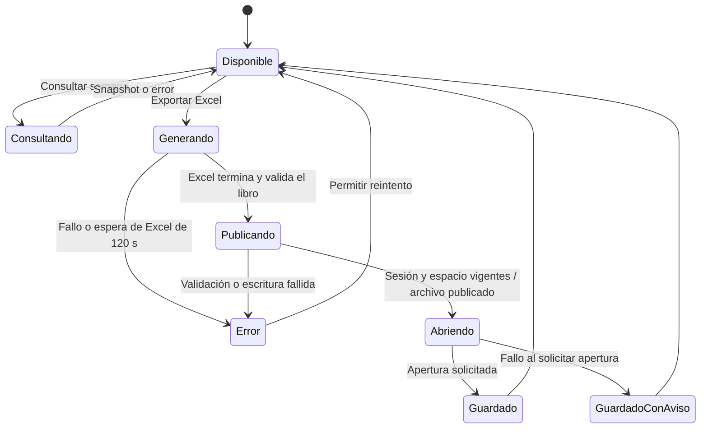

# Reporte semanal: consulta y exportación

`weekly_snapshot({ reportingDate })` consulta la semana de lunes a domingo de la
fecha seleccionada. `export_weekly({ reportingDate })` genera el mismo snapshot,
conserva la plantilla KMX-FW embebida y publica el archivo en
`<espacio activo>/exports/KMX-FW-<fecha>-<identificador>.xlsx`.
Ambos comandos requieren sesión vigente Supervisor/Admin y las validaciones de
datos, confianza y espacio aplicadas por Rust.

La respuesta de exportación contiene `path` (ruta absoluta), `sha256` (hash de los
bytes publicados) y `open_error` (`null` o aviso de fallo de apertura). Después de
publicar, se solicita al sistema operativo abrir el archivo con la aplicación
asociada a `.xlsx`. Un fallo al solicitar apertura conserva el archivo y devuelve
su ruta y hash con el aviso; no convierte una publicación correcta en fallida.
La aceptación de la solicitud por Windows no confirma que Excel haya mostrado
la ventana.

La pantalla distingue consulta de generación y bloquea nuevas solicitudes mientras
su operación está pendiente. El límite de 120 segundos corresponde al proceso
PowerShell que automatiza Excel, incluyendo apertura, cálculo, guardado,
verificación y cierre. No limita las lecturas del espacio de trabajo ni garantiza
un tiempo total de exportación. Al agotarse, Rust termina y recoge ese proceso,
devuelve error y no publica ni abre el archivo incompleto.

La exportación ejecuta el trabajo en un hilo bloqueante, sin retener el mutex de
sesión durante la generación. Antes de publicar, bajo ese mutex, comprueba la
misma época de sesión, usuario, huella, identidad y ruta del espacio y revalida la
autorización. Un cierre de sesión o cambio de espacio impide publicar el resultado.
Los temporales de cada solicitud se limpian al salir, dentro de `exports`.

Terminar PowerShell por tiempo agotado no garantiza el cierre de un servidor COM
de Excel bloqueado: nunca se terminan globalmente las instancias de Excel del
usuario. La validación nativa debe comprobar este caso y la apertura del `.xlsx`.
