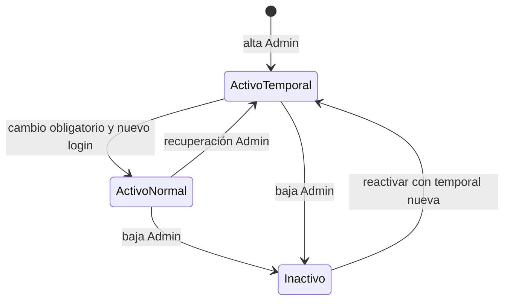

# Acceso, cuentas y confianza

Política de acceso EasyFAB. Disponibilidad y comprobaciones pendientes: [plan](../product/plan-maestro.md). Evidencia de acceso inicial: [primer acceso](../product/execution/f01/first-access.md).

La contraseña definitiva y la temporal tienen exactamente **8 caracteres**. Temporal aleatoria sin letras ambiguas, vigencia de 24 horas y cambio obligatorio. No se exige mezcla artificial de símbolos.

## Máquina de estados

| Estado | Autoridad y acciones permitidas | Persistencia |
|---|---|---|
| Sin sesión | Elegir usuario e ingresar | Sin token persistente |
| Temporal pendiente | El titular puede autenticar la temporal con su usuario EasyFAB | Hash Argon2id, revisión y vencimiento firmados en `team.json` |
| Cambio obligatorio | Solo cambiar contraseña o cerrar sesión; no emitir temporales ni operar proyectos | Sesión restringida en Rust |
| Normal | Operaciones según rol; cada comando protegido revalida firma y revisión | Credencial definitiva firmada en `engineers/<id>/profile.json` (layout 2) o `<id>.json` (legacy 1) |
| Temporal vencida | Rechazar acceso; pedir nueva temporal al Admin | No se prorroga automáticamente |
| Inactivo o firma alterada | Rechazar acceso y operaciones protegidas | Estado y firma de rol canónicos |

El cambio exitoso termina la sesión: se debe ingresar con la contraseña nueva. Un error de guardado conserva el estado anterior y no concede acceso normal. Reiniciar la aplicación elimina la sesión. Cinco intentos activan una espera local de 30 segundos; no es un bloqueo corporativo permanente.

## Responsabilidades y contratos

- `auth/crypto.rs`: Argon2id, HMAC y generación aleatoria.
- `auth/models.rs`: tipos de los contratos.
- `auth/directory.rs`: llave, lectura del directorio, rutas de usuario y publicación JSON.
- `auth/credentials.rs`: transiciones de acceso, cambio y recuperación.
- `auth_commands.rs`: adaptadores IPC y sesión en memoria.
- `Login.tsx` y `components/auth/`: acceso, cambio y recuperación en componentes separados; ninguna decisión de permisos se delega a React.

Contratos canónicos: [directorio](../../contracts/v1/team.schema.json), [perfil](../../contracts/v1/engineer_tasks.schema.json) y [acceso IPC](../../contracts/v1/auth.schema.json). El alta inicial y cada reset crean una revisión nueva. Se firma adicionalmente la credencial temporal, su fecha, ID EasyFAB y revisión: alterar el hash o vencimiento del JSON invalida el acceso. La firma de rol mantiene el formato canónico `id:role:status`.

## Recuperación administrativa

1. El administrador ingresa con una sesión normal; una sesión con cambio pendiente no tiene esta facultad.
2. Selecciona un usuario activo y emite una temporal. El backend renueva revisión, hash y vencimiento en `team.json`; nunca escribe el perfil de otro ingeniero.
3. La temporal se muestra en la pantalla administrativa hasta ocultarla o salir. Se entrega por un canal corporativo autorizado; no se envía ni registra automáticamente.
4. Tras sincronizar `team.json`, la contraseña y las sesiones anteriores quedan rechazadas en la siguiente operación protegida. El titular usa la temporal y cambia obligatoriamente su contraseña.

No hay restablecimiento público por correo ni preguntas secretas. Si el único administrador pierde el acceso, requiere recuperación operativa del responsable custodio de confianza: no existe una puerta trasera automática. Solo Admin administra altas/bajas de Engineer y Supervisor. La recuperación del único Admin se concreta en D04 del plan; no se habilita otro administrador por esta previsión.

## Alta inicial y confianza entre equipos

El espacio nuevo muestra Crear administrador inicial en la app; solo se permite cuando team.members está vacío y no hay sesión. Genera temporal de 8 caracteres y exige cambio. Herramienta local alternativa: `cargo run --manifest-path src-tauri/Cargo.toml --example provision_admin -- "<raíz>/easy-fab/data"`. Solo acepta un directorio vacío y reutiliza la misma alta inicial del backend. Solicita ID/nombre y genera una temporal de 8 caracteres válida 24 horas; se muestra únicamente al operador de consola. La UI es el camino principal. La migración del Admin existente se registra en PLAN-003B/PLAN-006.

La raíz se crea con aleatoriedad del sistema en `%LOCALAPPDATA%/EasyFAB/master.key` (32 bytes), sin sobrescribir. El arranque normal solo la lee y falla cerrado si falta. El Admin debe aprovisionar la misma confianza por un canal corporativo controlado en los equipos autorizados; nunca sincronizar esta llave en OneDrive ni enviarla por IPC. Una llave independiente en cada PC no verifica el directorio común.

HMAC es un secreto compartido: quien controla una copia de la llave puede generar firmas. Este mecanismo no protege frente al propietario de Windows con acceso a ese secreto. El endurecimiento mediante custodia de Windows y un mecanismo de verificación sin distribuir capacidad de firma requiere una decisión arquitectónica posterior.

## Límites operativos explícitos

OneDrive proporciona sincronización eventual: no se promete revocación instantánea en un equipo desconectado. Los cambios de contraseña se realizan con la sesión EasyFAB autenticada y escriben solo su perfil, conservando actividades y campos existentes. Cada comando de negocio futuro deberá revalidar sesión y rechazar `must_change_password=true`.

La integridad HMAC detecta edición, pero no proporciona protección contra restaurar una copia antigua completa de los archivos. Borrar/restaurar el perfil puede volver a hacer efectiva una temporal todavía vigente. La prevención de rollback/consumo irreversible distribuido requiere un registro de autoridad con otro modelo de sincronización y queda fuera de esta fase; no afirmar que la temporal es de uso único bajo manipulación de archivos.

Los usuarios existentes sin los nuevos campos de revisión requieren reprovisión administrativa; no se inventan valores de confianza en runtime.

## Directorio administrativo (PLAN-003A)

Solo una sesión normal Admin revalidada puede consultar el directorio completo, crear usuarios, activar/desactivar o recuperar su acceso. El IPC devuelve únicamente ID, nombre, rol y estado; nunca hashes, firmas ni la llave. La temporal se devuelve exclusivamente después de guardar el alta/reactivación y se muestra hasta ocultarla o salir.

- Alta: ID EasyFAB único sin distinguir mayúsculas, nombre y rol engineer/supervisor; área fija 10.FAB. Genera temporal de 8 caracteres por 24 horas y estado activo. No crea ni modifica el perfil del titular.
- Baja: cambia estado a inactivo y firma el rol; renueva la revisión de credenciales para invalidar el acceso anterior. Conserva la cuenta y todas sus actividades. No hay borrado físico ni reutilización del ID.
- Reactivación: solo desde inactivo, firma estado activo y genera temporal/revisión nuevas; debe volver a cambiar contraseña antes de acceder normalmente. No restaura la contraseña anterior.
- Admin: la cuenta administrativa está protegida frente a cambios de estado. Esta fase no crea más administradores ni edita roles/identidades existentes.
- La recuperación de contraseña sigue disponible para usuarios activos desde el mismo directorio; no reactiva usuarios inactivos.

Archivos: `auth/users.rs` concentra reglas administrativas, `user_commands.rs` adapta IPC, `UserDirectory.tsx` presenta el listado y los estados, `NewUserForm.tsx` resuelve el alta. Las reglas de expiración y generación de temporales se comparten con la recuperación existente.

Prueba manual: ingresar como Admin, crear un ingeniero con un ID EasyFAB nuevo y entregar la temporal. Cerrar sesión e ingresar como ese ingeniero en el mismo equipo, cambiar la contraseña y verificar que el directorio Admin no aparezca. Desde Admin, desactivar/reactivar y comprobar que se exige una temporal nueva. La cuenta Admin no ofrece desactivación.

## Identidad EasyFAB independiente de Windows (PLAN-003B)

La cuenta se define por ID, nombre, rol y contraseña EasyFAB. No se solicita, almacena ni valida la identidad Windows del titular. Cada sesión escribe únicamente su perfil según el layout del manifiesto, con rutas validadas por Rust y sin aceptar rutas desde el frontend. Pueden existir varias cuentas EasyFAB en el mismo equipo y utilizarse desde otro equipo habilitado con acceso al mismo OneDrive y a la confianza local de la aplicación.

El usuario confirmó que solo existe Admin y autorizó ajustar directamente su registro/perfil. Se conserva contraseña, revisión, actividades y firma de rol; se actualiza la firma de metadatos temporales al payload `[id,password_hash,credential_revision,temporary_expires_at]` y se cambia el nombre del perfil a su ID. Antes de modificar se validan firmas y propietario, y se conservan respaldos de los dos archivos. No se añade compatibilidad de Windows al runtime.

OneDrive mantiene sincronización eventual. La partición sigue siendo por usuario EasyFAB; no garantiza ausencia de conflictos si se utiliza simultáneamente la misma cuenta para editar desde dos equipos.

## Resolución del espacio

Todas las operaciones resuelven data desde el espacio activo y verifican su identidad antes de leer credenciales. La instalación/configuración y el acceso son estados separados; ver [espacio canónico](espacio-de-trabajo.md). No se acepta data_dir desde React. Cambiar espacio cancela accesos en curso y exige no tener sesión.

## Autoridad de operación por cuenta

Admin administra team.json y catálogos; consulta proyectos. El único Supervisor activo escribe projects.json y valida cierres cuando esa capacidad esté disponible. Engineer escribe actividades y avances propios. El cierre autoritativo pertenece al dominio Supervisor, ligado a revisión y evidencia; nunca concede aprobación un booleano escrito por el ingeniero.

Una sesión de trabajo por cuenta. Completar sincronización antes de cambiar de equipo; no escribir simultáneamente con la misma cuenta. El mismo portable sirve a todos los roles, sin nombres ni equipos fijados al compilar. El acuerdo de equipo de 2026-10-28 considera un Admin, un Supervisor y dos ingenieros; no impone un límite de licencias ni autoriza borrar cuentas.
