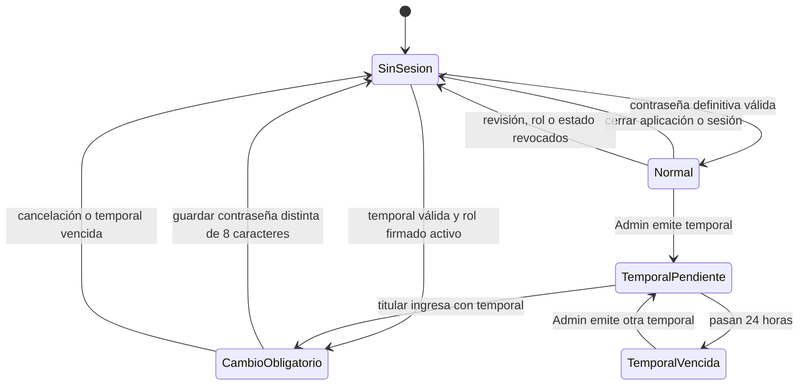

# Acceso y recuperación de contraseña — fase 2

Estado de implementación: en validación. Política acordada: exactamente **8 caracteres** para la contraseña definitiva y la temporal. No se exige una mezcla artificial de símbolos. Temporal aleatoria de 8 caracteres sin letras ambiguas, vigencia de 24 horas.

## Máquina de estados

| Estado | Autoridad y acciones permitidas | Persistencia |
|---|---|---|
| Sin sesión | Elegir usuario e ingresar | Sin token persistente |
| Temporal pendiente | Solo el titular con su cuenta Windows puede autenticar la temporal | Hash Argon2id, revisión y vencimiento firmados en `team.json` |
| Cambio obligatorio | Solo cambiar contraseña o cerrar sesión; no emitir temporales ni operar proyectos | Sesión restringida en Rust |
| Normal | Operaciones según rol; cada comando protegido revalida firma y revisión | Credencial definitiva firmada en `engineers/<windows_username>.json` |
| Temporal vencida | Rechazar acceso; pedir nueva temporal al Admin | No se prorroga automáticamente |
| Inactivo o firma alterada | Rechazar acceso y operaciones protegidas | Estado y firma de rol canónicos |

El cambio exitoso termina la sesión: se debe ingresar con la contraseña nueva. Un error de guardado conserva el estado anterior y no concede acceso normal. Reiniciar la aplicación elimina la sesión. Cinco intentos activan una espera local de 30 segundos; no es un bloqueo corporativo permanente.

## Responsabilidades y contratos

- `auth/crypto.rs`: Argon2id, HMAC y generación aleatoria.
- `auth/models.rs`: tipos de los contratos.
- `auth/directory.rs`: llave, lectura del directorio, rutas de usuario y publicación JSON.
- `auth/credentials.rs`: transiciones de acceso, cambio y recuperación.
- `auth_commands.rs`: adaptadores IPC y sesión en memoria.
- `Login.tsx`: formularios y presentación del estado; ninguna decisión de permisos se delega a React.

Contratos canónicos: [directorio](../../contracts/v1/team.schema.json), [perfil](../../contracts/v1/engineer_tasks.schema.json) y [acceso IPC](../../contracts/v1/auth.schema.json). El alta inicial y cada reset crean una revisión nueva. Se firma adicionalmente la credencial temporal, su fecha, identidad Windows y revisión: alterar el hash o vencimiento del JSON invalida el acceso. La firma de rol mantiene el formato canónico `id:role:status`.

## Recuperación administrativa

1. El administrador ingresa con una sesión normal; una sesión con cambio pendiente no tiene esta facultad.
2. Selecciona un usuario activo y emite una temporal. El backend renueva revisión, hash y vencimiento en `team.json`; nunca escribe el perfil de otro ingeniero.
3. La temporal se muestra en la pantalla administrativa hasta ocultarla o salir. Se entrega por un canal corporativo autorizado; no se envía ni registra automáticamente.
4. Tras sincronizar `team.json`, la contraseña y las sesiones anteriores quedan rechazadas en la siguiente operación protegida. El titular usa la temporal y cambia obligatoriamente su contraseña.

No hay restablecimiento público por correo ni preguntas secretas. Si el único administrador pierde el acceso, requiere recuperación operativa del responsable custodio de confianza: no existe una puerta trasera automática. El directorio de altas/bajas y un procedimiento de contingencia con un segundo administrador siguen pendientes de la fase 3.

## Alta inicial y confianza entre equipos

Herramienta local explícita: `cargo run --manifest-path src-tauri/Cargo.toml --example provision_admin -- "<Management/Data>"`. Solo acepta un directorio vacío, conserva un respaldo y solicita una temporal de 8 caracteres por entrada estándar. La entrada de consola es visible; usar una terminal privada. No se ha ejecutado contra datos corporativos.

La raíz se crea con aleatoriedad del sistema en `%LOCALAPPDATA%/EasyFAB/master.key` (32 bytes), sin sobrescribir. El arranque normal solo la lee y falla cerrado si falta. El Admin debe aprovisionar la misma confianza por un canal corporativo controlado en los equipos autorizados; nunca sincronizar esta llave en OneDrive ni enviarla por IPC. Una llave independiente en cada PC no verifica el directorio común.

HMAC es un secreto compartido: quien controla una copia de la llave puede generar firmas. Este mecanismo no protege frente al propietario de Windows con acceso a ese secreto. El endurecimiento mediante custodia de Windows y un mecanismo de verificación sin distribuir capacidad de firma requiere una decisión arquitectónica posterior.

## Límites operativos explícitos

OneDrive proporciona sincronización eventual: no se promete revocación instantánea en un equipo desconectado. Los cambios de contraseña se realizan con la cuenta Windows asignada y escriben solo su perfil, conservando actividades y campos existentes. Cada comando de negocio futuro deberá revalidar sesión y rechazar `must_change_password=true`.

La integridad HMAC detecta edición, pero no proporciona protección contra restaurar una copia antigua completa de los archivos. Borrar/restaurar el perfil puede volver a hacer efectiva una temporal todavía vigente. La prevención de rollback/consumo irreversible distribuido requiere un registro de autoridad con otro modelo de sincronización y queda fuera de esta fase; no afirmar que la temporal es de uso único bajo manipulación de archivos.

Los usuarios existentes sin los nuevos campos de revisión requieren reprovisión administrativa; no se inventan valores de confianza en runtime.
