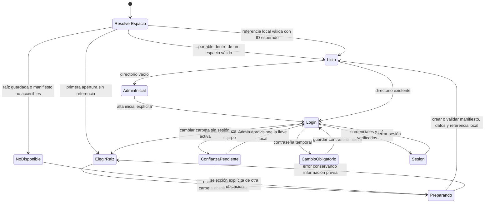
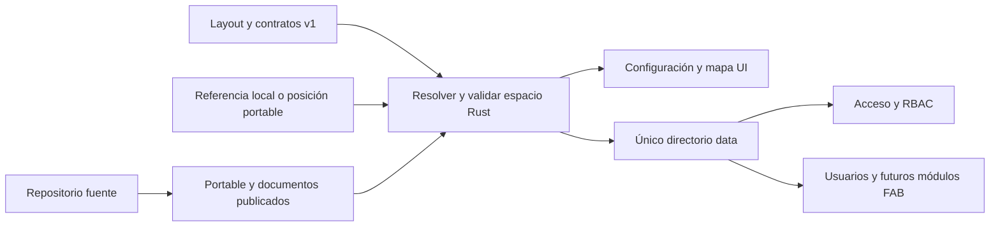

# Espacio canónico e instanciación de EasyFAB

Documento canónico de espacios e instanciación. Fecha: 2026-10-28.

PLAN-013: espacios nuevos usan `workspace.json.profile_layout_version=2`.
Si el campo falta, el contrato lo define como legacy 1; un manifiesto faltante,
inválido, desconocido o con maintenance=true bloquea acceso. No inferir versión de
los archivos ni probar ambas rutas. Ver [carpetas personales](../product/execution/f02/acceptance.md).

## Autoridad y mapa único

La **raíz compartida** es la carpeta corporativa elegida en cada equipo. La ubicación inicial es `ENGINEERING FILES - 10.FAB` de OneDrive corporativo. El nombre del perfil Windows y su ruta absoluta pueden variar entre equipos; no forman parte de la identidad del usuario EasyFAB ni del espacio.

### Regla de autoridad de Configuración

La carpeta seleccionada es la raíz que contiene `easy-fab/`; no se debe seleccionar su subcarpeta `data/`. `installation.json` conserva `workspace_root` y `workspace_id` por equipo. Las rutas compartidas del sistema (datos, documentos publicados, contratos publicados, portable, exportaciones y respaldos) derivan de esa raíz mediante el layout canónico. La referencia, la llave de confianza y las preferencias locales permanecen en la instalación local conforme a la separación siguiente.

La selección guardada prevalece incluso si el ejecutable se abre desde otra carpeta. Si la raíz resulta inaccesible, la referencia es inválida o el ID no coincide, el acceso falla explícitamente: no se cambia a la propuesta OneDrive, a la carpeta del ejecutable, al repositorio ni a datos locales alternativos. Cambiar de raíz requiere una selección explícita sin sesión activa; no implica migrar, copiar o fusionar datos.

### Criterios de aceptación de ubicación

- Una raíz corporativa accesible con nombre distinto al sugerido se puede seleccionar y sus rutas se resuelven bajo `<raíz>/easy-fab/`.
- Al reiniciar o abrir un portable desde otra ubicación, la referencia guardada válida sigue siendo la autoridad.
- Una raíz guardada no disponible o con identidad distinta bloquea el acceso sin crear otro espacio.
- Dos equipos pueden usar rutas absolutas diferentes para la misma carpeta compartida; el ID del espacio debe coincidir y cada equipo necesita su confianza local.
- Ningún módulo operativo calcula una ruta independiente de la configuración; cambiar de raíz exige cerrar sesión y validar el espacio elegido.

Estos criterios son requisitos de comportamiento; la aprobación de pruebas automatizadas no acredita por sí sola permisos, disponibilidad de red ni sincronización entre equipos.

```text
<raíz compartida configurable>/
└── easy-fab/
    ├── workspace.json          Identidad estable del espacio; sin rutas absolutas ni secretos
    ├── data/                  Única fuente de datos operativos
    │   ├── team.json
    │   ├── projects.json
    │   ├── issues.json
    │   ├── config_plant.json
    │   └── engineers/<id-easyfab>/
    │       ├── profile.json
    │       └── evidence/
    ├── software/easyfab.exe    Ejecutable portable publicado
    ├── docs/architecture/     Mapa, acceso e invariantes de la versión publicada
    ├── contracts/v1/          Contratos publicados con esa versión
    ├── exports/               Reportes generados
    └── backups/               Respaldos y restauración controlada
```

[workspace.layout.json](../../contracts/v1/workspace.layout.json) es la única definición de nombres relativos que consume Rust. React recibe rutas resueltas del backend; no construye rutas. El manifiesto [workspace.json](../../contracts/v1/workspace.schema.json) contiene solo versión e ID estable. Las copias de documentación y contratos publicadas en el espacio provienen del repositorio de desarrollo y del binario; no constituyen otra fuente editable de contratos.

## Tres ámbitos, sin mezclar responsabilidades

| Ámbito | Contenido | Autoridad |
|---|---|---|
| Repositorio `C:/Dev/easyfab` | Código, contratos y documentación fuente; pruebas y compilación | Desarrollo |
| Raíz compartida / `easy-fab` | Datos, identidad del espacio, portable, documentos publicados, exportaciones y respaldos | Equipo FAB con RBAC EasyFAB |
| Instalación local `%LOCALAPPDATA%/EasyFAB` | `installation.json` (raíz local e ID esperado), `master.key` (secreto de confianza local), preferencias locales de aplicación y usuario | Equipo local / usuario EasyFAB; llave bajo custodia Admin |

La llave no se copia al espacio compartido ni se incluye en el ejecutable. Los datos operativos y las contraseñas en claro no se guardan en la referencia local. El código sigue en el repositorio; no se mueve a OneDrive como parte de la instalación portable. Un equipo que abre un espacio existente requiere la confianza local aprovisionada por Admin; encontrar la carpeta no concede acceso.

## Decisión: configuración local y datos compartidos

Decisión aprobada el 2026-10-28: guardar la configuración propia del equipo y las preferencias personales en `%LOCALAPPDATA%/EasyFAB`; mantener la configuración general y la información operativa en `<raíz configurada>/easy-fab/`. Se utiliza LocalAppData porque las rutas y preferencias pertenecen a esa instalación y pueden diferir entre equipos.

| Información | Ubicación y alcance |
|---|---|
| Carpeta configurada e ID esperado | `installation.json`, por instalación; contrato existente |
| Llave de confianza | `master.key`, local y bajo custodia Admin; nunca sincronizada |
| Preferencias de aplicación | LocalAppData, por instalación; sin datos operativos ni autoridad sobre el espacio |
| Tema, tamaño de interfaz y filtros personales | LocalAppData, separados por ID estable de espacio e ID de usuario EasyFAB |
| Directorio de usuarios, roles y credenciales protegidas | `data/team.json` y `data/engineers/<id>/profile.json` en layout 2; legacy 1 conserva `<id>.json` hasta mantenimiento |
| Configuración de planta y catálogos generales | `data/config_plant.json` y contratos correspondientes |
| Proyectos, actividades, avances e incidencias | Archivos canónicos en `data/`, con partición de escritura y RBAC |
| Reportes, respaldos, contratos y documentación publicados | Directorios compartidos definidos por el layout |

Las preferencias locales solo personalizan la experiencia; no otorgan permisos, sustituyen la autenticación ni contienen contraseñas. La sesión continúa en memoria. La cuenta EasyFAB y sus avances se recuperan desde el espacio compartido al usar otro equipo autorizado; sus preferencias locales no se transfieren automáticamente. Varias cuentas que usan una misma instalación deben mantener preferencias separadas; el ID de espacio evita mezclar usuarios con el mismo ID en espacios diferentes.

Restablecer preferencias conserva `installation.json`, `master.key` y todos los datos compartidos. Una preferencia ausente o inválida permite recuperar valores de interfaz predeterminados; una referencia de espacio inválida o no disponible sigue bloqueando el acceso. Las preferencias nunca habilitan una fuente local alternativa de datos.

La [política de preferencias](preferencias.md) desarrolla aislamiento, recuperación y preservación de referencia, llave y datos. No añadir campos a `installation.json` sin actualizar su contrato. Estado de implementación y verificación: [plan](../product/plan-maestro.md).

## Arranque e instanciación



Prioridad de resolución: **referencia local guardada**, **posición del portable** (`easy-fab/software/easyfab.exe`) cuando no existe configuración, **propuesta de OneDrive**. La propuesta automática no escribe datos. Una referencia guardada que falla nunca provoca seleccionar silenciosamente otra carpeta ni crear un equipo vacío.

Crear/abrir un espacio es una acción explícita. Se valida ruta absoluta existente y versión del manifiesto, se reutilizan archivos existentes sin sobrescribirlos, se crea una identidad única solo para un espacio nuevo y se guarda la referencia local al terminar. Un manifiesto existente con datos faltantes exige restauración: no se autocompleta con un directorio de usuarios vacío.

Cambiar carpeta exige cerrar sesión y cancela accesos en curso. Conecta el espacio elegido; **no traslada ni fusiona datos**. Cada comando de datos revalida el ID del espacio activo antes de resolver su directorio. El paso Admin inicial solo está permitido cuando el directorio está vacío; los accesos posteriores siguen [la máquina de estados de credenciales](auth.md).

## Escritura y acceso

| Operación | Dominio de escritura |
|---|---|
| Elegir espacio desde un equipo | Solo referencia local, después de crear/validar el espacio compartido |
| Primer alta Admin | `data/team.json` vacío y llave local, mediante acción explícita |
| Alta/baja/reactivación/recuperación | `data/team.json`, solo sesión normal Admin |
| Cambiar contraseña y actividades propias | Partición propia según manifiesto: `data/engineers/<id>/profile.json` (2) o `<id>.json` (1) |
| Proyectos | `data/projects.json`, único Supervisor activo; Admin consulta |
| Incidencias | `data/issues.json`, append-only según contrato |
| Exportación | `exports/`; no implementada todavía |
| Publicación portable/documentos | `software/`, `docs/`, `contracts/`; distribución controlada |

La partición es por usuario EasyFAB. OneDrive sincroniza eventualmente; editar la misma cuenta desde dos equipos a la vez puede producir conflicto. La referencia local no demuestra que OneDrive haya terminado de sincronizar.

## Dependencias y traslado desde el baseline



El baseline guardaba datos en `Management/Data`. El usuario confirmó que solo existe Admin y autorizó traslado directo. La migración valida firma de rol, firma temporal, propietario y firma de la credencial definitiva, guarda respaldo de los archivos originales, mantiene contraseña/revisión/actividades, retira el campo Windows y ubica el perfil por ID EasyFAB. Después se traslada el directorio completo a `easy-fab/data`; no queda otro directorio operativo en la ubicación anterior.

Rollback: conservar cerrada la aplicación, restaurar los dos archivos originales del respaldo y devolver el directorio a `Management/Data` antes de usar el binario anterior. No combinar un binario anterior con el manifiesto/datos nuevos. Los respaldos de hash y datos de usuarios permanecen en el mismo dominio corporativo de acceso.

## Portable

`npm.cmd run tauri -- build` genera el release con frontend embebido y `bundle.active=false`. Se publica como `easy-fab/software/easyfab.exe`, junto con la versión de documentos/contratos. En la primera apertura sin configuración, el portable encuentra su espacio por su ubicación; la selección guardada por el usuario manda en aperturas posteriores; puede copiarse localmente y abrir el espacio mediante configuración. No requiere Node ni Rust en el equipo de uso; WebView2 y los permisos corporativos sobre la carpeta siguen siendo prerrequisitos.

No se publica el ejecutable de depuración ni se incluye una llave maestra en el binario. Una nueva compilación no autoriza sobrescribir datos, reiniciar usuarios ni cambiar el ID del espacio.
