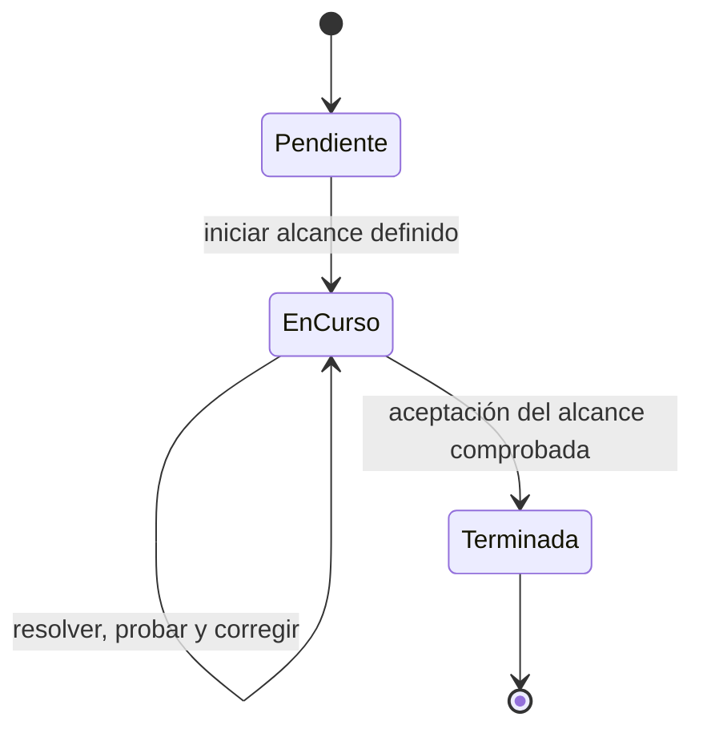

# Guía de trabajo y desarrollo

Procedimiento común para personas y agentes. Entrada al proyecto: [índice](indice.md).

## Entender → resolver → verificar y entregar

1. Identificar la solicitud, el resultado observable y su aceptación. Consultar la historia en el [plan](product/plan-maestro.md), las funciones en el catálogo y solo los contratos y reglas que consume el alcance.
2. Resolver el encargo. En programación, conectar reglas, persistencia y pantalla cuando corresponda; incorporar pruebas de comportamiento y regresión en la misma entrega. Resolver las dependencias reales antes de sus consumidores, sin detener trabajo independiente.
3. Verificar el resultado, corregir fallos y entregar evidencia, límites y siguiente acción. Actualizar el plan si cambia el trabajo pendiente y la fuente funcional o técnica si cambia su definición.

Una consulta, diagnóstico o propuesta se entrega como tal; no requiere una historia de programación artificial. Una propuesta no equivale a una decisión aprobada. Los criterios de entrada y salida no añaden fases ni permisos manuales.

## Registro del trabajo

El plan es el único lugar del estado de desarrollo: **pendiente**, **en curso**, **terminada**. Cada historia expresa resultado, aceptación, impedimento concreto si existe y enlace a evidencia. Un impedimento contiene causa, responsable y acción de desbloqueo; no es otro estado.

Una entrega parcial conserva sus comprobaciones pendientes como historias explícitas. No declarar terminada toda una capacidad porque exista código o un contrato. Cancelación se registra con motivo, sin presentarla como terminación. Los estados de acceso, avance y aprobación son lógica del producto y conservan sus contratos.

Reutilizar evidencia existente por alcance y fecha. Guardar un checkpoint breve cuando se necesite continuidad: referencias, decisiones, verificaciones y próximo paso. No crear STATUS, roadmap, porcentajes ni otra tabla de estados en catálogo o arquitectura.

## Estrategia e integración

Entregar una función verificable por vez. Secuencial por defecto; la concurrencia requiere autorización y tareas independientes, entradas/salidas claras, archivos disjuntos y un integrador que compruebe el conjunto. Serializar cambios a archivos compartidos, sin convertirlo en dependencia de módulos completos. No exigir scheduler, DAG persistente, JSON o checkpoints sin consumidor real.

Antes de añadir un destino o módulo, definir su responsabilidad, ubicación, acciones por rol y aceptación en el catálogo. Los cambios de datos requieren contrato; Rust aplica autorización y persistencia. Consultar arquitectura antes de modificar ubicación, confianza o particiones. No migrar datos ni publicar un portable como consecuencia implícita de otro cambio.

## Verificación y cierre

Aplicar [testing.md](architecture/testing.md): pruebas sintéticas aisladas, regresiones para bugs y comprobación de errores/permisos. Ejecutar `npm test` y `pwsh -NoProfile -File scripts/verify_contracts.ps1` antes de cerrar una entrega. Mantener ambos comandos mientras no se revise su repetición en CI.

Para documentación, comprobar enlaces y referencias retiradas y revisar `git diff --check`; no añadir pruebas que solo repitan texto. Registrar comandos y resultados reales. Si una comprobación requerida falta, informar causa y conservar ese alcance pendiente.

Los mocks IPC no acreditan RBAC Rust ni WebView. Piloto, dos equipos, Excel oficial y publicación corresponden a las historias que entregan esas capacidades. Publicar requiere autorización concreta de destino y versión, respaldo y aceptación aplicable.
