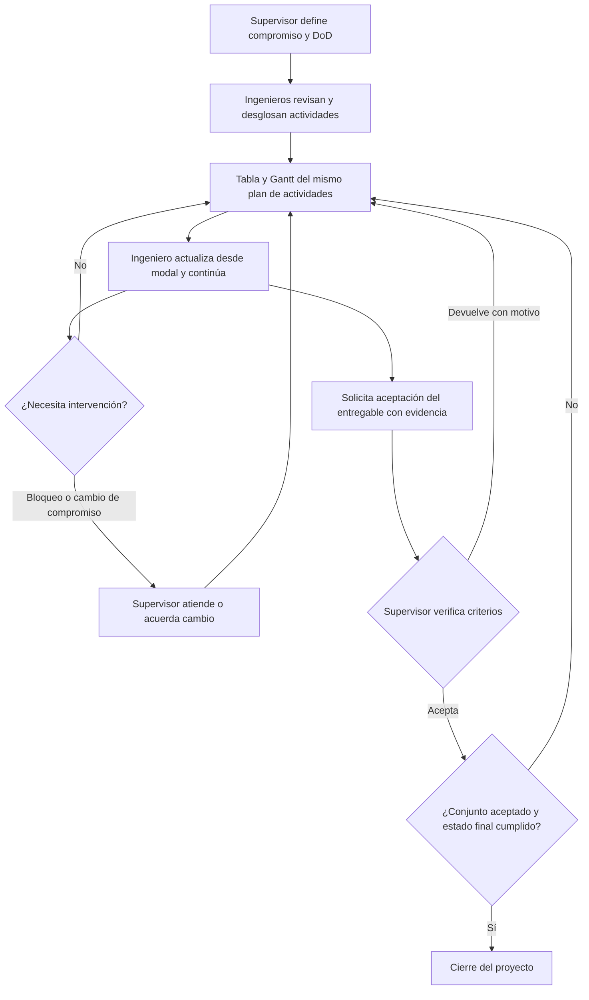

# Catálogo funcional de EasyFAB

Define las superficies, funciones y permisos esperados. El [plan](plan-maestro.md) indica qué está implementado y qué falta; la [navegación](../architecture/navegacion.md) define ubicación y comportamiento. Las fichas no acreditan implementación.

## Roles y acceso

- Todos ingresan con ID y contraseña EasyFAB, independientes de Windows. Detalle de cuentas y confianza: [auth](../architecture/auth.md).
- Admin administra usuarios y catálogos y consulta proyectos. No registra proyectos ni aprueba cierres.
- El único Supervisor activo registra y modifica el plan de los proyectos y valida cierres. Engineer registra y edita actividades en proyectos asignados y solicita cierre.
- Reporte de incidencias previsto para los tres roles; seguimiento/correcciones se concretan antes de implementarse. Contratos y RBAC determinan las operaciones efectivas.

## Mapa funcional

| ID / superficie | Responsabilidad y funcionalidades esperadas | Roles y límites |
|---|---|---|
| NAV-01 · Top Nav y panel lateral | Identidad, fecha, navegación, sección activa y cierre de sesión. Panel superpuesto con cierre exterior y teclado. | Todos; destinos según permisos. |
| INI-01 · Inicio | Resumen de avances, próximos cierres, vencidos y pendientes de revisión. Abrir el registro de origen desde cada indicador. | Engineer: sus asignaciones; Supervisor/Admin: panorama general. |
| PRO-01 · Proyectos: listado y alta | Consultar y abrir proyectos en un cronograma tabular único. Seleccionar semana (lunes a domingo), mes o año, fecha de referencia y periodo anterior/siguiente u Hoy; mostrar proyectos cuyo intervalo inicio–objetivo intersecta el periodo, con días en semana/mes y meses en año. Abrir el detalle para actividades y avance; el calendario representa planificación, no ejecución. Supervisor registra nombre, ingenieros responsables y fechas conforme al contrato vigente. | Solo Supervisor registra y modifica el plan; Admin consulta. Engineer consulta sus proyectos autorizados. |
| PRO-02 · Detalle, actividades y avance | Consultar fechas y estado; registrar y editar actividades del proyecto asignado, hitos y evidencias; solicitar cierre y consultar resultado. | Ingenieros asignados colaboran en actividades conservando autoría e historial; Supervisor valida cierres. Admin consulta. |
| LIN-01 · Problemas de línea: registro e historial | Registrar equipo/línea, descripción y fecha; paro y scrap cuando apliquen; consultar seguimiento hasta resolución. | Reporte previsto para los tres roles; responsables de seguimiento y correcciones por definir antes de implementar. |
| CFG-01 · Configuración | Preferencias de la aplicación y conexión con la carpeta de gestión. Cada módulo mantiene una responsabilidad propia; Usuarios y Catálogos tienen destinos laterales independientes. | Todos; opciones filtradas por rol. |
| CFG-02 · Carpeta de gestión | Mostrar carpeta activa; tras cerrar sesión, seleccionar y validar otra raíz. Mostrar errores sin perder la referencia válida ni migrar datos. | Sin sesión activa; permisos de carpeta y confianza siguen aplicando. |
| CFG-03 · Preferencias | Personalizar tema, tamaño de interfaz y filtros por espacio/usuario. | Preferencias personales sin autoridad sobre identidad o permisos. |
| ADM-01 · Usuarios | Consultar directorio; abrir «Nuevo usuario» en un modal flotante para dar de alta Engineer/Supervisor, desactivar/reactivar y recuperar acceso desde la fila del usuario activo mediante contraseña temporal con cambio obligatorio. | Solo Admin con sesión normal. Baja lógica; sin eliminar historial, cambiar roles ni crear otro Admin. Un solo Supervisor escritor activo. |
| ADM-02 · Catálogos | Mantener líneas, equipos y tipos de falla: añadir, editar nombres, asociar equipos a líneas y activar/desactivar sin eliminar identificadores ni referencias. | Admin edita; lectura según necesidad y contrato. |

## Reglas funcionales

Decisión de producto de 2026-10-29: PRO-01 permite asignar varios ingenieros con
igual responsabilidad; sustituye la asignación de un único responsable. Un proyecto
autorizado para Engineer incluye su ID de sesión revalidada en `engineer_ids`.
Solo el Supervisor puede modificar el compromiso del proyecto: nombre, fechas
comprometidas, asignaciones al proyecto, objetivo y condiciones de cierre.
Los ingenieros asignados desarrollan y actualizan la planeación de actividades
para cumplir ese compromiso. Admin consulta. Esta distinción sustituye la regla
general de edición exclusiva de todo el «plan» por el Supervisor.
Solo el Supervisor resuelve conflictos entre ediciones concurrentes de una
actividad; conserva las versiones originales en el historial y publica una
resolución explícita. Los ingenieros asignados no eligen unilateralmente una
versión ganadora ni descartan el trabajo concurrente de compañeros.
Los ingenieros asignados pueden registrar trabajo y editar actividades de sus
compañeros dentro del mismo proyecto, conservando creador e historial de editores.
Rust filtra proyectos y aplica permisos; Engineer no registra proyectos ni recibe
proyectos ajenos o el directorio general. Esto no concede edición de credenciales,
asignaciones del plan ni aprobación de cierres. El [plan](plan-maestro.md) registra
la implementación. El [contrato de resultados](../../contracts/v1/project_results.md)
define la partición activa y su activación explícita; la [propuesta anterior](execution/project-storage-proposal.md)
se conserva como antecedente, no como otro contrato vigente.
El [contrato IPC](../../contracts/v1/project_registration.schema.json) define la respuesta.

| ID / ubicación | Responsabilidad | Condición para implementar |
|---|---|---|
| CAR-01 · Proyectos → Carga del equipo | Comparar esfuerzo asignado con capacidad disponible y consultar calendario/Gantt. Supervisor/Admin. | F09/F12; D05: calendario, jornadas, esfuerzo y capacidad neta. No inferir carga del número de proyectos. |
| REP-01 · Inicio → Resumen y exportación KMX-FW | Seleccionar periodo, consultar consolidado y exportar formato oficial. Supervisor/Admin; detalle desde cada proyecto. | F13/F14; plantilla oficial D06 y snapshot consistente. No habilitar exportación sin esas bases. |

## Planeación por entregables y cierre verificable

Decisión de producto de 2026-10-29: probar una planeación orientada al estado
final deseado. Amplía la definición de PRO-01 y PRO-02: además del objetivo,
el plan describe uno o más entregables cuyo cumplimiento permite cerrar el
proyecto. Las actividades describen el trabajo para alcanzarlos. La aceptación
de esta capacidad y su piloto se registran en el [plan](plan-maestro.md).

- El Supervisor define el resultado final, el alcance y los entregables de cierre
  al preparar el plan. Para simplificar y agilizar la planeación, el objetivo global
  engloba los alcances del proyecto y la definición de cierre se combina con las
  subactividades de trabajo (sprints o historias para continuar): cada subactividad
  embebe directamente su entregable, condición verificable de cierre y evidencia requerida,
  eliminando la captura en tablas separadas o el mapeo manual redundante. Las fechas y
  asignaciones mantienen las reglas del plan; no se incorpora otro rol aprobador.
- Los ingenieros asignados organizan y registran las actividades para alcanzar
  esos resultados. Cada actividad se vincula con el entregable al que contribuye;
  una actividad intermedia terminada no acredita por sí sola el cierre del proyecto.
- Tabla de actividades y Gantt dentro del proyecto muestran los mismos registros:
  entregable asociado, actividad, responsable entre los asignados, fechas previstas,
  dependencias, estado y avance. Cambiar la previsión no cambia la fecha compromiso.
  El Gantt no requiere captura adicional ni reprograma compromisos automáticamente.
- «Actualizar actividad» abre un modal flotante contextual. Permite guardar avance
  o estado sin autorización del Supervisor; nota y evidencia son opcionales salvo
  evidencia necesaria al solicitar aceptación. No se vuelve a pedir el proyecto,
  el entregable ni las fechas si no están cambiando. Se conservan borradores ante
  error, se evitan envíos duplicados y se mantiene navegación por teclado.
- Un bloqueo registra impedimento, actividad afectada, ayuda o decisión requerida,
  fecha y seguimiento hasta resolución. Es independiente del porcentaje de avance
  y de «en riesgo». El Supervisor puede atenderlo sin aprobar la actualización.
  Solo cambios de compromiso, bloqueos que requieren intervención, conflictos
  concurrentes y solicitudes de aceptación necesitan su atención; las actualizaciones
  ordinarias quedan disponibles para consulta sin generar aprobaciones.
- Terminar una actividad es una declaración de ejecución del ingeniero. La revisión
  formal corresponde al entregable, mediante solicitud explícita con evidencia.
  Esto sustituye como comportamiento objetivo el acoplamiento actual entre 100 %
  de actividad y solicitud de aprobación. La transición debe preservar decisiones
  históricas; no convertirlas automáticamente en aceptación de entregables nuevos.
- Una entrega intermedia puede comprobar una dependencia o permitir una decisión.
  No exige una aprobación adicional por defecto. El alcance determina si una compra
  termina al formalizarse, al recibirse o al quedar el activo en operación.
- Los criterios particulares expresan qué debe cumplir cada entregable. La
  Definition of Done común exige criterios cumplidos, evidencia recuperable y
  aceptación del Supervisor; incluye documentación y transferencia cuando el
  alcance las requiera. Adjuntar un archivo o declarar 100 % no demuestra aceptación.
- El cierre del proyecto requiere que todos los entregables de cierre acordados
  estén aceptados y que se cumpla el estado final. El Supervisor puede devolver
  una entrega indicando el criterio incumplido. La revisión debe identificar el
  plan, los criterios y la evidencia evaluados; cambios posteriores del plan no
  convierten automáticamente una aceptación anterior en aceptación del nuevo alcance.
- En mejoras de proceso, el plan incluye línea base, meta medible, periodo de
  comprobación y responsable del control posterior cuando sean necesarios para
  demostrar y sostener el resultado. No se exige DMAIC completo a toda compra o gestión.

Ejemplo ilustrativo, sin umbrales predeterminados: «estación disponible para
producción» puede requerir equipo recibido e instalado, desempeño comprobado
contra la meta acordada y operación transferida. Cotizar, emitir la orden e
instalar son actividades; recepción, resultados de prueba y transferencia son
evidencias según los criterios definidos para ese proyecto.

Esta decisión amplía la planeación y el cierre, sin definir una fórmula de avance
por conteo de entregables. Las compuertas 0/25/50/75/100 pueden mantenerse para
captura, separadas de la aceptación del entregable en el flujo objetivo. Los contratos,
la persistencia y la interfaz deben adaptarse antes de exigir este flujo en la
aplicación; no se reinterpretan ni migran proyectos existentes implícitamente.

### Flujo objetivo para revisión

La ruta cotidiana es tabla → modal → guardar → continuar. El seguimiento de
bloqueos no detiene actividades independientes. Las ramas de intervención no
son aprobaciones de cada actualización. El [plan de trabajo](plan-maestro.md#evolución-hacia-planeación-y-cierre-por-resultados)
ordena contratos, persistencia, interfaz y comprobación del piloto.

Relaciones, reglas de fechas/dependencias, retiro/reapertura y política de
permisos se concretan en el [contrato del dominio](../../contracts/v1/project_results.md).
Una actualización ordinaria no modifica el compromiso ni solicita aceptación.

## Ampliar una función

Antes de añadir un módulo o destino, describir aquí su necesidad, ubicación, acciones permitidas por rol y límites. Una acción o filtro puede vivir en una superficie existente. La historia y su aceptación se registran en el plan; contratos y arquitectura conservan los detalles técnicos.

Comportamiento de menú, foco y preservación de captura: [navegación](../architecture/navegacion.md).

Preferencias incluye tema y tamaño; filtros se concretan ante una necesidad real. No modifica identidad, permisos, referencia del espacio ni llave. Estructura y defaults: contrato v1; ubicación y recuperación: arquitectura de preferencias.

## Objetivos de uso

- Captura diaria menor a 60 s y registro de incidencias menor a 30 s, medidos en piloto; no son tiempos ya acreditados.
- Objetivo de cero archivos en conflicto, comprobado en escenarios soportados. La partición no garantiza convergencia de archivos compartidos ni escritura simultánea de una cuenta en varios equipos.
- Reporte KMX-FW con paridad de datos y presentación respecto a la plantilla oficial elegida.
- Operación local sin servidores externos de aplicación; disponibilidad sujeta al equipo, permisos y carpeta corporativa.

## Términos de trabajo

Hito: avance de ingeniería en compuertas 0/25/50/75/100. El contrato actual asocia
100 a solicitud de revisión de actividad; el flujo objetivo separa esa declaración
de la solicitud explícita de aceptación del entregable, como define la sección de
planeación por entregables. Evidencia: soporte ligado a una actividad/revisión.
Downtime: paro no programado en horas. Scrap: piezas desechadas. KMX-FW: formato
semanal de reporte de Fabrication. Reglas de capacidad, pesos y desviación se
concretan en D05 del plan; no asumir una fórmula definitiva a partir de estos nombres.

El proyecto pasa de **Sin iniciar** a **En curso** al guardar cualquiera de sus ingenieros asignados
el primer hito de actividad o avance general mayor que cero, o tiempo trabajado
mayor que cero. Una actividad con 0 % y sin horas positivas no lo inicia. El inicio
se conserva aunque se corrijan después esos valores a cero; no sustituye estados
En pausa/Completado ni aprueba cierres al llegar al 100 %. La consulta proyecta el
estado desde el trabajo registrado sin escribir `projects.json`. En el formato anterior,
los registros permanecen en perfiles personales; en proyectos activados por resultados,
el inicio se conserva desde sus revisiones históricas de trabajo positivo. La activación
y la fuente de cierre se definen en el contrato del dominio.
