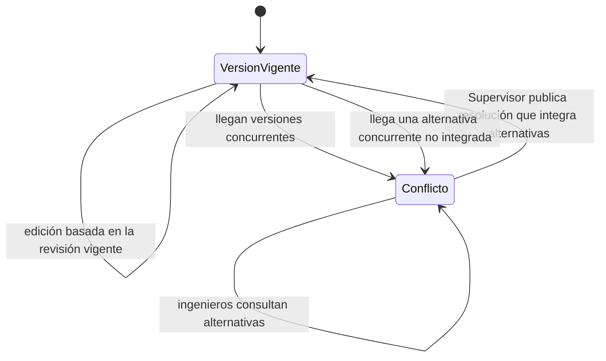
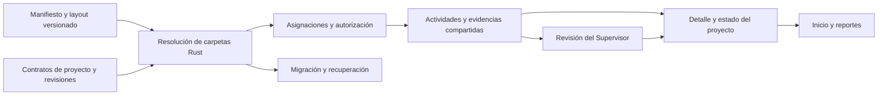

# Propuesta para colaboración y almacenamiento por proyecto

Antecedente de diseño: 2026-10-29. La evolución aprobada de 2026-10-30 se concreta en el [contrato vigente](../../../contracts/v1/project_results.md) y el [espacio de trabajo](../../architecture/espacio-de-trabajo.md#proyectos-activados-por-resultados). Las rutas candidatas y decisiones abiertas de este documento no son instrucciones vigentes ni autorizan migraciones. Estado y evidencia: [plan](../plan-maestro.md).

## Necesidad confirmada

- Varios ingenieros asignados al proyecto con la misma responsabilidad.
- Los asignados pueden registrar trabajo y editar actividades de sus compañeros dentro del mismo proyecto.
- El almacenamiento permanece en el OneDrive corporativo configurado.
- Solo el Supervisor puede modificar el plan del proyecto, conforme al [catálogo funcional](../catalogo-modulos.md#reglas-funcionales).
- Solo el Supervisor resuelve conflictos entre ediciones concurrentes, conservando ambas versiones en el historial.

No se han definido borrado, reasignación de autoría ni una fórmula de avance consolidado. No se deducen esos permisos de la edición compartida de actividades.

## Diagnóstico del diseño actual

El [espacio vigente](../../architecture/espacio-de-trabajo.md) guarda proyectos en `data/projects.json`; el Supervisor es su único escritor. Cada perfil personal reúne credenciales protegidas, actividades, avances y marcadores de inicio. Las evidencias se ubican junto al perfil. `activities.rs` consulta esos perfiles y `reporting.rs` consume el detalle resultante.

Esto permite separar escritores por cuenta, pero acopla el trabajo a su autor. Autorizar a un compañero a escribir el perfil ajeno mezclaría la colaboración del proyecto con la persistencia de credenciales y con actividades de otros proyectos. Una carpeta por proyecto permite separar ambos dominios.

`data_store::publish` detecta cambios observados localmente y publica mediante archivo temporal y reemplazo. No coordina dos copias de OneDrive todavía sin sincronizar. Microsoft documenta conflictos al modificar archivos desde equipos que sincronizan a la vez: [restricciones de OneDrive](https://support.microsoft.com/en-us/onedrive/restrictions-and-limitations-in-onedrive-and-sharepoint).

## Estructura candidata

```text
easy-fab/
  workspace.json
  data/
    team.json
    engineers/<usuario>/profile.json       Identidad y credenciales; sin trabajo del proyecto
    projects/<id-proyecto>/
      project.json                        Datos del plan y asignaciones; escritor Supervisor
      activities/<id-actividad>/
        revisions/<id-revision>.json       Versiones completas e inmutables del trabajo
      evidence/<id-archivo>.<extension>    Adjuntos inmutables referenciados por revisión
      reviews/<id-decision>.json           Decisión del Supervisor sobre una revisión concreta
  exports/
  backups/
```

Los nombres son candidatos, no campos ni rutas ya publicados. Los IDs son estables y generados por la aplicación; renombrar un proyecto no cambia su carpeta. Toda ruta deriva en Rust del espacio activo. No se añade un selector de raíz por proyecto.

`project.json` sería la fuente de los datos del proyecto. `projects.json` dejaría de ser una segunda fuente editable. El listado se obtendría de las carpetas; cualquier índice futuro tendría que ser reconstruible y no autoritativo, y solo se justificaría con mediciones.

## Escritura compartida con OneDrive

Cada guardado de una actividad crea un archivo nuevo con un ID único y referencia a su revisión anterior. Incluye el creador original y quien realizó la edición, con identidad derivada de la sesión. Cambiar el editor no cambia al creador. El contrato definitivo debe concretar autenticidad, validación de identidad, contenido y relaciones entre revisiones.

No habría un archivo `latest.json` que todos debieran actualizar. La aplicación resuelve la revisión vigente desde las relaciones entre versiones:

- Una continuación válida: se muestra esa versión.
- Dos continuaciones de una misma versión: se conservan ambas y se muestra un conflicto.
- Resolución explícita: una versión nueva referencia las dos alternativas y conserva el contenido elegido o integrado.
- Referencia todavía ausente durante sincronización: se informa lectura incompleta; no se inventa una versión ni se borra información.

Ejemplo: Ana y Luis parten de la versión 7. Ana guarda 8A y Luis guarda 8B sin haber recibido 8A. Al sincronizar, EasyFAB conserva ambas. No decide por fecha ni sobrescribe una con la otra. El Supervisor consulta ambas versiones y publica la resolución; Ana y Luis pueden consultar el conflicto, pero no resolverlo.

La resolución crea una nueva versión que referencia todas las alternativas visibles que integra. No borra ni modifica los archivos originales. Si llega otra alternativa después de resolver, se vuelve a mostrar el conflicto: una resolución local no prueba que OneDrive haya terminado de sincronizar. Dos resoluciones concurrentes tampoco se eligen por fecha; deben integrarse explícitamente.



Propuesta de interacción: mostrar las alternativas y sus autores/editores en el detalle de la actividad; ofrecer al Supervisor conservar una o integrar su contenido en una nueva versión. Durante un conflicto no presentar una alternativa como avance o cierre definitivo. El contrato debe precisar cómo se excluyen resultados ambiguos del consolidado sin ocultar el problema.

La partición por actividad reduce el alcance del conflicto respecto de un único JSON para todo el proyecto. Los archivos nuevos por revisión evitan que dos editores normales reemplacen el mismo archivo, pero no prometen sincronización instantánea, disponibilidad completa ni exclusión distribuida. Se conserva la condición vigente de una sesión de trabajo por cuenta, salvo decisión explícita posterior.

Las decisiones de cierre permanecen vinculadas a una revisión exacta. Una edición posterior conserva la decisión histórica sin aprobar automáticamente el nuevo contenido. No se trasladan credenciales a las carpetas de proyectos.

## Impacto y orden de integración



1. Aplicar la edición exclusiva del plan y la resolución de conflictos por el Supervisor; acordar uso del avance general y tratamiento de documentos editables.
2. Definir contratos y nueva versión del layout; implementar lectura/escritura con fixtures aislados, sin tocar datos reales.
3. Probar dos autores: actividades distintas, misma actividad sin sincronización, dependencias recibidas fuera de orden, adjuntos incompletos, edición posterior a aprobación y usuario no asignado.
4. Implementar migración explícita con aplicación cerrada y respaldo: separar trabajo de credenciales, conservar IDs y verificar referencias, adjuntos y decisiones. Si una referencia histórica no puede conservarse, detener la migración para resolverla; no invalidarla silenciosamente.
5. Publicar el cambio de versión solo después de validar el conjunto. No mantener doble escritura entre perfiles y proyectos. Un fallo previo a la activación conserva el origen como autoridad; el destino preparado aún no es operativo.

Rollback: antes de reabrir la versión anterior, cerrar las aplicaciones y restaurar el conjunto coherente de manifiesto, datos y binario del respaldo. Si ya hubo capturas en el formato nuevo, conservarlas y resolver su recuperación antes de volver atrás. No mezclar versiones de aplicación con layouts incompatibles.

## Decisiones abiertas

| Decisión | Propuesta inicial |
|---|---|
| Avance del proyecto | No promediar declaraciones personales; definir una única regla antes de consolidar |
| Archivos de trabajo vs evidencias | Distinguir documentos editables de evidencias de una revisión; no sobrescribir una evidencia aprobada |
| Lectura entre compañeros | Confirmar alcance del detalle y archivos compartidos al implementar la colaboración |

El cambio a listas de ingenieros iniciado antes de esta revisión sigue incompleto. No acredita todavía edición compartida, almacenamiento por proyecto ni migración. Esta propuesta no debe usarse como evidencia de esas capacidades.
