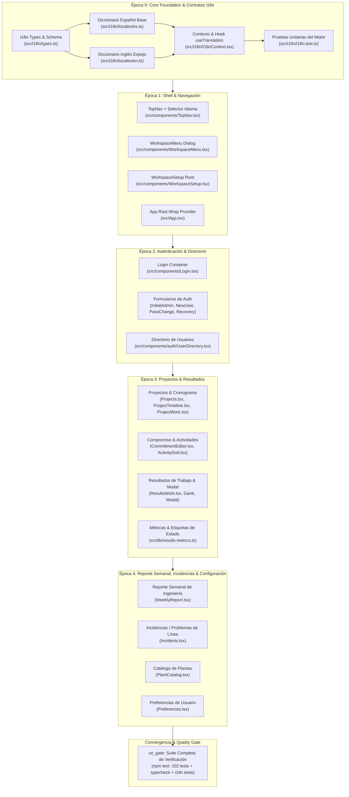

# Plan: Internacionalización (i18n) Español / Inglés en EasyFAB

Fecha: 2026-11-10 · Responsable: Alan · [Índice](../indice.md) · [Plan maestro](plan-maestro.md).

Este documento especifica la estrategia, arquitectura y fases de ejecución para migrar todos los textos de la interfaz de EasyFAB a un sistema de internacionalización estructurado con soporte bilingüe (**Español `es-MX`** e **Inglés `en-US`**).

---

## 1. Alcance y objetivos

1. **Extracción exhaustiva de cadenas**: Mover el 100 % de los textos visuales de la aplicación (etiquetas, botones, encabezados, estados, modales, avisos de validación y accesibilidad aria) a catálogos centralizados.
2. **Soporte bilingüe completo**: Catálogo maestro en Español (`es.ts`) como idioma canónico por defecto y catálogo espejo en Inglés (`en.ts`).
3. **Cero regresiones**: Preservar el 100 % de las aserciones existentes en los 15 archivos de pruebas frontend (102 tests pasando actualmente).
4. **Selector accesible e inmediato**: Permitir la alternancia de idioma en la barra superior (`TopNav`) y en la vista de configuración (`Preferences`), con persistencia local en `localStorage`.

---

## 2. Diagnóstico y decisiones de diseño (`hss-simplifier`)

Aplicando las directrices de **`/hss-simplifier`**, se minimizan los componentes y capas intermedias para evitar sobreingeniería:

1. **Cero dependencias externas pesadas**:
   - Se descarta instalar frameworks de traducción pesados (`i18next`, `react-i18next`) que introducen dependencias runtime asíncronas innecesarias y riesgos con React 19.
   - Se implementa un subsistema TypeScript nativo, ligero y reactivo mediante React Context (`I18nContext`) y el hook `useTranslation()`.
2. **Garantía estática de paridad de claves**:
   - Las claves usan notación plana por puntos: `"section.key"` (ej. `"common.save"`, `"auth.login_title"`).
   - El tipo `TranslationKey = keyof typeof es` define el conjunto canónico.
   - El catálogo en inglés implementa `satisfies Record<TranslationKey, string>`, lo que fuerza a `tsc` a validar en tiempo de compilación que no falte ninguna clave ni se usen claves inexistentes.
3. **Consolidación de cadenas duplicadas**:
   - Textos comunes repetidos en múltiples componentes ("Guardar", "Cancelar", "Cerrar sesión", "En curso", "Terminada", roles) se unifican bajo el namespace `common.*` y `roles.*`.
4. **Formateo de fechas por locale**:
   - `dateFormat` se adapta dinámicamente según el idioma activo (`es-MX` vs `en-US`), manteniendo la zona horaria de planta (`America/Mexico_City`).
5. **Persistencia local sin alteración de contratos Rust**:
   - La preferencia de idioma se guarda en `localStorage` bajo `easyfab_language`. No altera el contrato cerrado `contracts/v1/user_preferences.schema.json` ni requiere cambios en el backend Rust.

---

## 3. Orquestación DAG (`captis-dag-orchestration`)

La migración se modela como un grafo acíclico dirigido por épocas con superficies de escritura disjuntas (`writes`) que convergen en el sumidero de verificación de calidad (`ce_gate`):



---

## 4. Estructura de archivos y catálogos

```
src/
├── i18n/
│   ├── types.ts              # Contratos de tipos (Language, TranslationKey, Context)
│   ├── I18nContext.tsx        # Provider y hook useTranslation()
│   ├── i18n.test.ts          # Pruebas unitarias de paridad, interpolación y reactividad
│   └── locales/
│       ├── es.ts             # Catálogo canónico en Español (SSOT)
│       └── en.ts             # Catálogo bilingüe en Inglés (100% paridad estricta)
```

### Secciones del catálogo (`TranslationKey`):
- `common.*`: Acciones generales (`save`, `cancel`, `back`, `close`, `retry`, `delete`, `loading`, `confirm`, `error`).
- `nav.*`: Menú principal, títulos de vista, accesibilidad.
- `workspace.*`: Conexión de carpeta activa, comprobación de espacio, rutas del sistema.
- `auth.*`: Login, selector de usuarios, PIN de 8 caracteres, cambio forzoso de contraseña, administración.
- `roles.*`: Denominaciones de roles de planta (`Administrador`, `Supervisor`, `Ingeniero`).
- `projects.*`: Lista, alta modal, WBS, fechas, asignaciones, estados (`Sin iniciar`, `En curso`, `Terminada`).
- `results.*`: Flujo por entregables, DoD, compromisos, revisiones, evidencias, bloqueos, cierres.
- `report.*`: Reporte semanal de ingeniería y consolidación.
- `incidents.*`: Problemas de línea de ensamble, paros, scrap y seguimiento.
- `settings.*`: Catálogos FAB, preferencias personales, selector de idioma.

---

## 5. Estrategia de verificación y aceptación

1. **Verificación de tipos estática**:
   `npm.cmd run typecheck` (`tsc -b --noEmit`) sin advertencias ni errores.
2. **Verificación de paridad y motor i18n**:
   `npx.cmd vitest run src/i18n/i18n.test.ts`
   - Paridad total: `Object.keys(es).sort() === Object.keys(en).sort()`.
   - Interpolación de parámetros dinámica (`{name}`, `{count}`).
   - Formateo de fecha según locale.
3. **No regresión del comportamiento existente**:
   `npm.cmd run test:frontend`
   - Los 102 tests de la suite continúan aprobando al 100%.
4. **Verificación visual y manual**:
   - Alternancia instantánea mediante control `[ES | EN]` en `TopNav`.
   - Persistencia de la elección al recargar o reiniciar la sesión.
