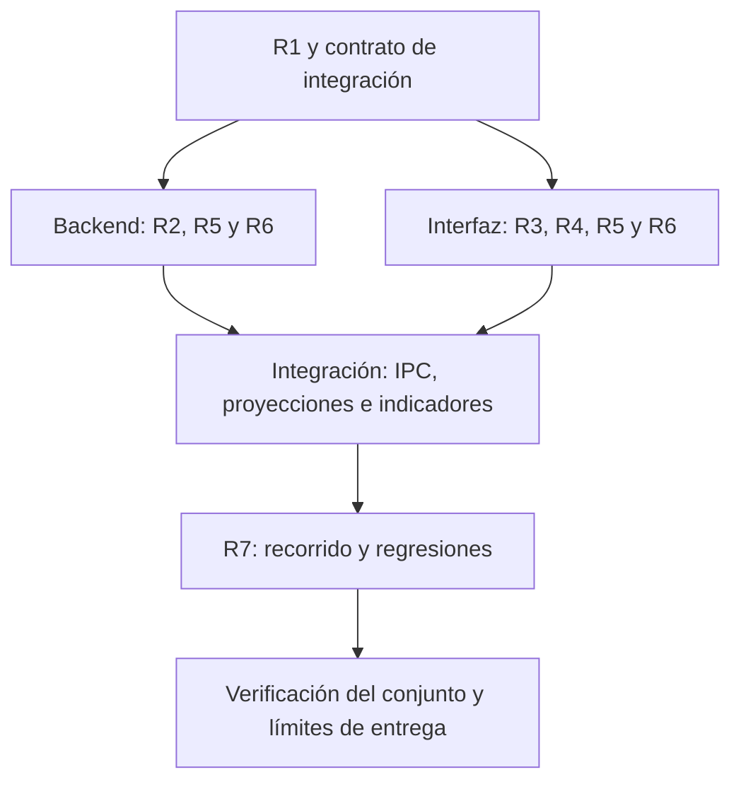
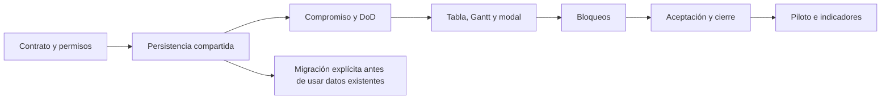
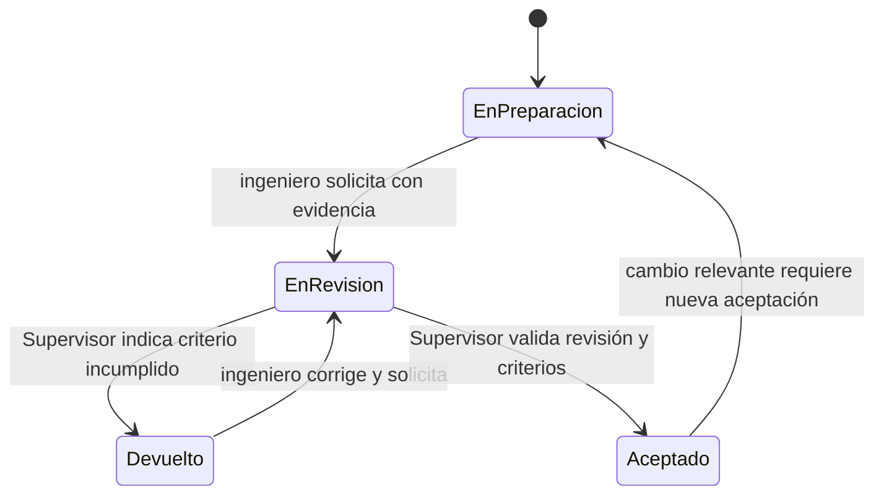

# Plan e historias de EasyFAB

Corte: 2026-10-30 · Responsable de producto: Alan · [Índice](../indice.md).

Este archivo concentra el orden de construcción, la aceptación y el estado del trabajo. El catálogo define funciones y arquitectura/contratos desarrolla sus reglas. Método y significado de estados: [guía de desarrollo](../desarrollo.md).

## Trabajo por hito

Cada fila es un alcance verificable. Los hitos agrupan historias, sin otro estado manual. Las filas terminadas acreditan únicamente el resultado indicado; las comprobaciones nativas pendientes se mantienen separadas. Los IDs Fxx/PLAN anteriores sirven para consultar evidencia, no para ordenar otro backlog.

| Hito / historia | Resultado y aceptación | Estado | Pendiente o impedimento | Evidencia |
|---|---|---|---|---|
| 2/3 · Evolución por resultados R1–R7 | Entregar secuencialmente el flujo acordado: compromiso y DoD, planeación de ingenieros, captura autónoma, bloqueos y aceptación de entregables | en curso | Flujo completo integrado y pruebas automáticas aprobadas (R1–R7a). R7b conserva revisión visual y piloto operativo pendientes | [Plan detallado](#evolución-hacia-planeación-y-cierre-por-resultados), [evidencia R1](execution/results-r1-acceptance.md) |
| 1 · Consolidación de persistencia | Autenticación y proyectos usan la misma publicación temporal que actividades, catálogos y preferencias, preservando validaciones de dominio | terminada | npm test: 48 casos de contratos, 50 pruebas frontend y 39 Rust aprobados; Gate 0 aprobado (tipos, cargo check y suites); diff --check aprobado. Incidencias conserva D01 en su historia; sin migración de datos ni acreditación de sincronización entre equipos | `src-tauri/src/data_store.rs`, [publicación de archivos](../architecture/espacio-de-trabajo.md#publicación-de-archivos) |
| 1 · Acceso y cuentas: base | Espacio, acceso propio y directorio Admin implementados y comprobados localmente | terminada | Validaciones adicionales en fila siguiente | [Primer acceso](execution/f01/first-access.md) |
| 1 · Carpetas personales | Layout elegido por manifiesto; cambio explícito reversible e idempotente, preservando credenciales | terminada | Adjuntos pertenecen al hito 3 | [Carpetas](execution/f02/acceptance.md) |
| 1 · Proyectos: alta y consulta | Supervisor guarda y recupera proyectos; Admin consulta; backend rechaza altas no autorizadas | terminada | Validación WebView en fila siguiente | [Proyectos](execution/f04/acceptance.md) |
| 2 · Prioridad activa y reordenamiento de proyectos | Supervisor reordena proyectos (#1, #2...) directamente en el cronograma fijando la prioridad activa del área; backend aplica RBAC y persiste orden en projects.json; Engineer y Admin consultan respetando el orden | terminada | 104 pruebas frontend (incluye reordenamiento y restricción de rol) y pruebas Rust aisladas de projects/commands aprobadas | `src-tauri/src/projects/mod.rs`, `src/features/projects/ProjectTimeline.tsx`, `contracts/v1/projects.schema.json` |
| 2 · Colaboración de varios ingenieros por proyecto | Asignar varios ingenieros con igual responsabilidad y editar actividades del mismo proyecto conservando autoría; Supervisor mantiene compromiso e integra conflictos | en curso | R2–R6 implementadas y comprobadas con sesiones sintéticas reales: revisiones por entidad, activación explícita y resolución en UI. Pendiente R7b; no se migró un espacio corporativo | [Evidencia integrada](execution/results-flow-acceptance.md), [contrato](../../contracts/v1/project_results.md) |
| 2 · Inicio automático del proyecto | Primer avance u horas positivas del responsable activa En curso; cero no inicia, correcciones no revierten inicio, pausa/cierre se conservan | en curso | Recorrido Rust aislado y 11 pruebas frontend de proyectos aprobados; TypeScript, cargo check, contratos JSON y diff --check aprobados. npm test/Gate 0 bloqueados por PowerShell; suite frontend: 40 pasan y falla acceso Login ajeno a este alcance. Suite Rust general: falla temporal data_store; revisión WebView pendiente | `src-tauri/src/activities_tests.rs`, `src/features/projects/Projects.test.tsx` |
| 1 · Altura adaptable de diálogos de proyectos | Alta y detalle dentro de la ventana con márgenes adaptables, cierre fijo y desplazamiento del cuerpo; alta en dos columnas según espacio, detalle ampliado y cronograma sin límite de ancho central | en curso | Compilación, 39 pruebas frontend y diff --check aprobados con ajuste de ancho. Regresión de alta conserva borrador al cerrar; prueba de acceso espera respuesta autorizada antes de crear. Revisión visual en ventana pequeña pendiente. npm test/Gate 0 bloqueados por PowerShell | `src/features/projects/Projects.test.tsx` |
| 1 · Identificador de página en Top Nav | Nombre del destino y foco al navegar en barra superior; retirar encabezado duplicado del contenido y franja del cronograma | en curso | 38 pruebas frontend, TypeScript, cargo check y diff --check aprobados. npm test/Gate 0 bloqueados por ejecución de scripts PowerShell. Revisión visual nativa pendiente | `src/components/TopNav.test.tsx`, `src/components/WorkspaceSetup.test.tsx` |
| 1 · Cronograma tabular de proyectos | Vista única con Semana/Mes/Año, navegación y filtrado por intersección de fechas; conserva apertura de detalle y alta autorizada | en curso | DOM: 9 pruebas del cronograma y 37 frontend aprobadas; 48 casos de preferencias, TypeScript y cargo check aprobados. Gate 0/npm test bloqueados por invocación PowerShell; Rust: 35 pasan y 1 falla en data_store por acceso denegado al temporal. Pendiente revisión visual WebView | `src/features/projects/Projects.test.tsx`, `src/features/projects/timeline.test.ts` |
| 1 · Navegación contextual | Menú, foco, roles y preservación de borradores comprobados con pruebas DOM | terminada | Validación visual nativa en fila siguiente | [Navegación](execution/navigation-acceptance.md) |
| 1 · Comprobar la base en escritorio | Acceso/reingreso por roles, carpetas, proyectos y navegación funcionan con datos sintéticos; comprobar uso entre equipos autorizados | pendiente | Ejecutar recorridos nativos descritos en evidencia, sin confundir mocks con escritorio | Evidencias anteriores |
| 1 · Alta modal y recuperación contextual de usuarios | Nuevo usuario arriba a la derecha del contenido abre modal flotante; conserva borrador al cerrar, contiene foco, impide cierre/envío duplicado al guardar y muestra temporal. Recuperación en columna propia desde la fila de cada cuenta activa, sin selector global | en curso | 50 pruebas frontend, TypeScript, cargo check y diff --check aprobados. npm test y Gate 0 bloqueados por política PowerShell en preferencias. Pendiente revisión visual WebView; no cambia autorización ni persistencia Rust | `src/components/auth/UserDirectory.test.tsx`, `src/components/Login.test.tsx` |
| 1 · Módulos administrativos con responsabilidad única | Usuarios y Catálogos como destinos laterales exclusivos de Admin; Configuración reúne preferencias y carpeta. Editar nombres de líneas/equipos y asociación del equipo sin cambiar IDs | en curso | 47 pruebas frontend y TypeScript aprobados; 48 casos de preferencias aprobados por invocación directa. npm test y Gate 0 bloqueados por política PowerShell; cargo check aprobado. Rust: 36 pasan y 1 falla en data_store por acceso denegado al temporal, ya registrado en otras historias. Pendiente revisión nativa WebView; alcance general de catálogos conserva su fila | `src/features/settings/PlantCatalog.test.tsx`, `src/components/WorkspaceMenu.test.tsx`, `src/components/WorkspaceSetup.test.tsx` |
| 1 · Catálogos FAB | Admin mantiene equipos y configuración general con referencias consistentes; alta de proyectos vincula Área de proceso a líneas activas y registro en formato de tabla interactiva (rejilla análoga a subactividades de proyectos) con edición en celda, pegado masivo desde Excel (TSV), filtros y persistencia inmediata o por lote | en curso | Formato tabular implementado con pestañas/vista completa, pegado TSV, orden correlativo, conteos y filtros; 107 pruebas frontend (7 de Catálogos FAB), TypeScript y cargo check aprobados | `src/features/settings/PlantCatalog.tsx`, `src/features/settings/PlantCatalog.test.tsx`, `src/features/projects/Projects.tsx` |
| 2 · Consulta de proyectos del ingeniero | Engineer consulta solo proyectos cuyo responsable coincide con su sesión; reingreso y aislamiento entre cuentas comprobados en Rust y navegación en DOM | terminada | Validación nativa separada en fila siguiente | [Consulta Engineer](execution/engineer-projects-acceptance.md) |
| 2 · Comprobar consulta Engineer en escritorio | Dos ingenieros ven únicamente sus proyectos asignados al ingresar y reingresar en WebView; no pueden registrar proyectos | pendiente | Ejecutar con datos sintéticos en equipos autorizados; no confundir DOM/IPC simulado con escritorio | [Recorrido](execution/engineer-projects-acceptance.md) |
| 2 · Captura diaria del ingeniero | Engineer asignado captura y recupera actividades/avances del proyecto autorizado, conservando autoría e historial; colaboración compartida conforme a R2–R4 | en curso | Backend/IPC y DOM comprobados. Modal contextual sin aprobación cotidiana; medir captura y completar aceptación nativa en R7b | [Evidencia integrada](execution/results-flow-acceptance.md) |
| 3 · Miniaturas de evidencias | Fotos PNG/JPG en detalle e histórico con vista previa y apertura del original; PDF y errores conservan apertura por nombre | en curso | 179 pruebas frontend aprobadas (incluye miniaturas, PDF y fallos), TypeScript y cargo check aprobados. npm test y Gate 0 detenidos por divergencia existente en tipos generados de operaciones. Pendiente revisión visual WebView | `src/features/projects/EvidenceAttachment.test.tsx` |
| 3 · Evidencias | Adjuntos inmutables recuperables por ID/revisión, rutas relativas y rechazo de acceso fuera del espacio | en curso | PDF/PNG/JPG hasta 20 MiB, integridad y recuperación histórica comprobados en fixtures; sin eliminación automática. Aceptación nativa y sincronización real en R7b | [Contrato](../../contracts/v1/project_results.md), [evidencia](execution/results-flow-acceptance.md) |
| 3 · Validar cierre | Supervisor acepta/devuelve entregables sobre solicitud explícita con evidencia; 100 de actividad no solicita ni concede aprobación en el flujo por resultados | en curso | R6 comprobada: decisiones firmadas, cierre del conjunto, reapertura y recuperación de revisiones antiguas. Pendiente aceptación nativa R7b | [Evidencia integrada](execution/results-flow-acceptance.md) |
| 4 · Incidencias | Registrar paro/scrap sin pérdida ni duplicación; correcciones como eventos | en curso | Código usa issue_events y lectura legacy de issues.json; reconciliar contrato/layout y verificar protocolo D01 entre equipos; confirmar nombre FAB | — |
| 4 · Panorama y capacidad | Totales y calendario coinciden con fixtures; datos faltantes explícitos | pendiente | Reglas FAB D05 | — |
| 5 · Reporte semanal | Exportar periodo a Excel oficial preservando datos, fórmulas, tablas, estilos e impresión | en curso | Código de snapshot y exportación presente en reporting.rs; seleccionar/validar plantilla D06 y comprobar Excel oficial | — |
| 6 · Contrato de preferencias | Esquema local cerrado y defaults comprobados; sin persistencia ni UI | terminada | Consumidores en fila siguiente | [Contrato](execution/preferences-contract-acceptance.md) |
| 6 · Preferencias persistentes | Aislar opciones por espacio/usuario, recuperar inválidas y restablecer sin tocar referencia, llave ni datos | en curso | Persistencia, IPC y controles presentes; completar comprobación del consumidor según política, aislamiento/reset y aceptación nativa | [Política](../architecture/preferencias.md) |
| 6 · Internacionalización (i18n) Español / Inglés | Mover textos a catálogos centralizados (es/en), proveer selector de idioma accesible (pre-login, barra superior y preferencias), soportar datos de negocio bilingües `"Español \| Inglés"` sin nuevos campos (`pick()` en lectura con fallback a español y texto completo en edición), traducir errores del backend Rust y exportar el reporte semanal en un libro Excel de dos hojas (`Reporte Semanal (ES)` y `Weekly Report (EN)`) | en curso | `src/lib/i18n.tsx`, `src/lib/bilingual.ts` y `src/lib/errors.ts` integrados en todas las vistas; `typecheck`, `vite build`, 22 suites / 177 pruebas frontend (Vitest) y 60 pruebas Rust aprobados. `test:contracts` pendiente en este equipo por ausencia de `pwsh` (PowerShell 7); pendiente validación visual nativa en WebView y Excel de escritorio | `src/lib/i18n.tsx`, `src/lib/bilingual.ts`, `src/lib/errors.ts`, `src-tauri/resources/export_weekly.ps1`, [preferencias](../architecture/preferencias.md) |
| 6 · Confianza y recuperación | Provisión, rotación y recuperación del único Admin; restauración comprobada | pendiente | D04 | — |
| 6 · Validación con equipo y distribución | Recorrido completo, dos equipos, reconexión, respaldo/rollback y portable reproducible comprobados | pendiente | Completar capacidades consumidas; publicación requiere destino, versión y autorización concreta | — |

**Siguiente historia propuesta:** R7b, aceptación nativa y piloto operativo. R1–R7a se implementaron e integraron dentro de la autorización de ejecución completa. Las historias previas de captura, colaboración, evidencias y cierre aportan sus dependencias reales, sin abrir una segunda implementación paralela.

## Evolución hacia planeación y cierre por resultados

Decisión de producto: conversación de 2026-10-29. Fuente funcional: [catálogo](catalogo-modulos.md#planeación-por-entregables-y-cierre-verificable).
Objetivo: que el Supervisor defina el compromiso y valide resultados, mientras los
ingenieros planean y reportan sin aprobaciones cotidianas. Este es el plan de
implementación; no acredita capacidades ni mejoras de eficiencia ya medidas.

### Diagnóstico SSOT delimitado

Diagnóstico inicial de planificación, anterior a R1; las correcciones de contrato
se acreditan en su [evidencia](execution/results-r1-acceptance.md).
Inspección estática de catálogo, contratos y consumidores citados. No es una
auditoría exhaustiva ni un Gate de paridad aprobado. Se preserva el trabajo ajeno
existente en el árbol; no se eliminan campos activos por llamarse legacy.

| Concepto | Fuente y consumidores inspeccionados | Diferencia verificada | Consolidación prevista |
|---|---|---|---|
| Autoridad de planeación | Catálogo; `projects.schema.json`, `project_registration.schema.json`; `projects/models.rs` | «Plan» agrupaba compromiso y detalle de ejecución | Catálogo distingue ambos; R1 proyecta permisos en contratos y Rust |
| Actividad compartida | Catálogo vs descripción de `activity_operations.schema.json` y `activities.rs` | Función objetivo colaborativa; contrato/almacenamiento todavía propios por ingeniero | R2 consume la historia existente de colaboración; una autoridad activa, sin doble escritura |
| Cierre | `activity_operations.schema.json`, `engineer_tasks.schema.json`, `ProjectWork.tsx` | 100 solicita revisión de actividad; la UI muestra «cierres por actividad» | R1/R6 separan ejecución de aceptación por entregable y conservan historial |
| Horas | `ActivityInput` en `src/lib/api.ts` y Rust vs `save_input` del contrato | Consumidores incluyen `hours_spent`, pero el esquema cerrado de entrada no lo incluye | R1 reconcilia el contrato antes de ampliar la captura |
| Avance | `ProjectWork.tsx`, `activities.rs` y contrato de operaciones | Declaración por ingeniero coexiste con hitos de actividad; no hay agregado canónico | Mostrar declaraciones como tales; aceptación X/Y separada; no promediar ni inferir capacidad |
| Tabla y Gantt | `ProjectWork.tsx`, `ProjectTimeline.tsx` | Captura en tarjetas/formulario y cronograma de proyectos; no constituyen tabla/Gantt de actividades | R4 usa una consulta del mismo conjunto, sin segundo calendario persistido |
| Bloqueos | `save_input.at_risk` y estado `At Risk` | Riesgo no representa impedimento con seguimiento | R5 añade contrato explícito; conserva la distinción riesgo/bloqueo |

Autoridades documentales: catálogo = reglas; contratos = estructuras/operaciones;
arquitectura = persistencia y confianza; este plan = aceptación y estado. Rust
aplica permisos y calcula proyecciones; TypeScript consume el contrato. Las
decisiones de aceptación son autoridad sobre una revisión, no booleanos editables
del ingeniero. Tabla, Gantt e indicadores leen esas mismas fuentes.

### Secuencia verificable

Ejecución autorizada completa. Orquestación `captis-dag-orchestration`: R1 sirve
de contrato de entrada; el integrador mantiene contratos, adaptadores y documentación.
Los especialistas escriben superficies disjuntas y entregan referencias y resultados,
sin duplicar contratos ni estados de desarrollo. Todo converge en `ce_gate`.

| Ruta | Escrituras exclusivas durante concurrencia | Entrega al integrador |
|---|---|---|
| Backend | `src-tauri/src/results_store.rs`, `src-tauri/src/results_store/` | Servicios, proyección de proyecto, revisiones firmadas y pruebas locales |
| Interfaz | `src/features/projects/ResultsWork*`, `src/features/projects/CommitmentEditor*`, `src/features/projects/results-work.css`, `src/features/projects/Projects.tsx`, `src/features/projects/Projects.test.tsx` | Flujo por roles, tabla/Gantt/modal y pruebas DOM |
| Integrador | Contratos/generador, adaptador `results-api.ts`, comandos IPC, integración de consumidores, documentación | Fuente única, aplicación conectada y evidencia final |

Las ramas solo se despachan tras fijar el contrato en
`contracts/v1/project_results_operations.schema.json` y su adaptador generado.
La matriz define propiedad de archivos, no otro backlog. Si una rama necesita
cambiar una interfaz, solicita el ajuste al integrador antes de consumirlo.

Los responsables siguientes son funciones de trabajo, no permisos nuevos. Cada
fila se integra y verifica antes de continuar con su consumidor.

| Historia / responsable | Resultado y aceptación | Dependencia | Estado |
|---|---|---|---|
| R1 · Contrato del flujo / Ingeniería + Supervisor | Contrato del dominio, modelos/validadores Rust, TS generado y consulta de capacidades comprobados. Horas/WBS reconciliados con entrada activa; fixtures, transiciones y permisos con sesiones reales aprobados. [Evidencia y límites](execution/results-r1-acceptance.md) | Contratos y semántica en [fuente canónica](../../contracts/v1/project_results.md); no activa persistencia ni flujo UI nuevos | terminada |
| R2 · Persistencia y colaboración / Ingeniería | Reutilizar el trabajo de almacenamiento por proyecto; conservar autoría, historial y revisiones. Rechazar edición no asignada y revisión obsoleta; conservar alternativas concurrentes y resolución exclusiva del Supervisor. Probar adjuntos y referencias incompletas; elegir layout versionado sin doble escritura | R1 y subalcance consumido de colaboración/D02/D03; no requiere cerrar módulos ajenos | terminada |
| R3 · Compromiso y DoD / Ingeniería + Supervisor | Alta/edición permite definir estado final, alcance y al menos un entregable con criterios y evidencia requerida; guarda/recupera revisiones. Solo Supervisor cambia compromiso; Engineer consulta y plantea aclaraciones sin alterarlo | R1–R2 | terminada |
| R4 · Planeación y captura rápida / Ingeniería | Tabla editable de actividades vinculadas a entregables con responsable asignado, fechas y dependencias; Gantt a su costado usa los mismos datos. Modal contextual guarda avance/estado sin aprobación, nota/evidencia opcionales. Previsión no mueve compromiso; errores conservan borrador; teclado, foco y prevención de duplicados comprobados | R2–R3; reglas de dependencias definidas en R1 | terminada |
| R5 · Bloqueos y atención / Ingeniería + Supervisor | Reportar impedimento y ayuda requerida desde actividad; consultar abiertos, antigüedad, atención y resolución con historial. Supervisor atiende sin aprobar avances; actividades independientes continúan. Probar permisos y reingreso | R4 y contrato de bloqueos R1 | terminada |
| R6 · Aceptación y cierre / Ingeniería + Supervisor | Solicitud explícita por entregable con criterios/evidencia identificados; aceptar o devolver con motivo. Actividad al 100 no solicita aprobación. Proyecto solo cierra con conjunto aceptado y estado final verificado; una edición relevante no hereda aceptación. Pruebas de permisos, evidencia alterada, retrabajo, cambios de alcance y reapertura | R3–R5 y autoridad de revisión R2 | terminada |
| R7a · Recorrido reproducible e indicadores / Ingeniería | Recorrido aislado con dos ingenieros/dos entregables, bloqueo, devolución, aceptación, conflictos y cierre; indicadores con corte, denominadores y faltantes; arnés nativo sintético compilado. [Evidencia integrada](execution/results-flow-acceptance.md) | R1–R6 integradas; no acredita comprensión humana ni dos equipos físicos | terminada |
| R7b · Aceptación nativa y piloto operativo / Supervisor + participantes | Revisar WebView/teclado/ventanas con participantes, ejecutar dos equipos autorizados y medir captura, comprensión y seguimiento; registrar ajustes y decisión de uso | Consolidación de `PRO-02` en **Planeación y previsión por entregables** (Gantt único por entregables, registro por contraste anterior/nueva condición en 4 grupos y reducción de textos/secciones redundantes); 112 pruebas frontend y binario `release` compilados. Faltan recorrido nativo completo, medición humana y OneDrive entre equipos | en curso |

R1–R7b desglosan la fila de evolución, sin repetir su estado en otros documentos.
Las filas existentes de colaboración, captura, evidencias y cierre conservan su
evidencia; al entregar cada alcance se actualizan por lo realmente comprobado.

### Simplificación y estados

Mantener todo dentro de Proyectos; Inicio consulta pendientes y abre su origen.
Una tabla y un Gantt, un modal contextual de actualización y una ruta de revisión
del entregable. No crear módulos separados para captura, aprobaciones diarias o
calendarios duplicados. Dependencias visibles sin motor de reprogramación automática
en este primer alcance. No incluir puntuaciones individuales ni rankings.

Máquina objetivo de aceptación del entregable (etiquetas de negocio; R1 define
su serialización). No sustituye estados de proyecto ni crea aprobaciones de tareas:

El cambio conserva la decisión histórica; R1 debe precisar qué cambios afectan
criterios o evidencia, cómo se retira una solicitud y cómo se reabre un proyecto.
Un bloqueo tiene seguimiento propio y no borra avance ni cambia aceptación.

### Indicadores del piloto y lectura semanal

Aplicación de KPI Reporting: contrato de lectura propuesto, sin actuals ni causas
medidas. Fuente futura: revisiones del compromiso, solicitudes/decisiones y eventos
de bloqueo del mismo proyecto; tiempos de captura observados en piloto, sin instalar
telemetría externa. Primer corte: semana completa lunes–domingo, America/Mexico_City;
mostrar fecha/hora de corte, proyectos incluidos, muestra y datos faltantes.

| Indicador / finalidad | Definición propuesta y lectura | Meta y comparación |
|---|---|---|
| Entregables aceptados a tiempo / resultado | De entregables con fecha compromiso venciendo en el periodo, cantidad aceptada a esa fecha / total que vencía. Mostrar n/N, % y pendientes vencidos; aceptación posterior no corrige cumplimiento histórico | Sin meta aprobada; comparar semanas completas compatibles y mostrar cambios de alcance/fecha |
| Tiempo de captura / fricción | Tiempo observado desde abrir modal con actividad seleccionada hasta confirmación de guardado. Mediana y p90 en segundos, n y fallos/reintentos; separar con/sin adjunto | Objetivo existente de captura diaria <60 s, a comprobar para el recorrido diario completo; no afirmar que cumplir el modal demuestra cumplir todo el recorrido |
| Aceptación en primera revisión / calidad | Entregables distintos cuya primera decisión fue aceptación / entregables distintos con primera decisión en el periodo; contar cada uno una vez. Mostrar solicitudes aún sin decisión aparte | Sin meta; comparar cohortes compatibles, sin atribuir devoluciones automáticamente a desempeño individual |
| Bloqueos abiertos / intervención | Conteo al corte y antigüedad en días naturales desde reporte; primera atención = tiempo hasta acción registrada del Supervisor. Resolución se mide por separado; no confundir comentario con desbloqueo | Sin SLA aprobado; ordenar por antigüedad/impacto registrado, sin semáforo inventado |

Supervisor revisa el conjunto semanalmente; ingenieros consultan el detalle propio
autorizado. Cero denominador = «no aplica», ausencia de datos = «sin datos», nunca
0 % por defecto. Cancelaciones y cambios de fecha/alcance se muestran aparte con
motivo y versión; se conserva la referencia comprometida para evitar mejorar el
indicador moviendo fechas. En R1 se concreta el evento que fija esa referencia.
No se suman porcentajes personales ni se interpreta cantidad de tareas como capacidad.
La carga de equipo depende de D05 y queda fuera de este primer piloto.

Formato de lectura: resultado y denominador → comparación compatible → pendientes
que requieren acción → responsable/siguiente paso. Explicar causas solo con evidencia;
separar dependencias externas y cambios acordados. Las métricas orientan seguimiento,
no demuestran por sí solas capacidad individual ni causalidad de una mejora.

### Entrada, comprobación y límites

R1 concreta estados y transiciones de actividades, retiro/reapertura de revisión,
efecto de ediciones, referencia de compromiso, cardinalidad de vínculos y reglas
de fechas/dependencias sin ciclos en el [contrato](../../contracts/v1/project_results.md).
R2 integra estos límites sin descartar cambios ajenos. El responsable de producto
valida solo decisiones de negocio pendientes; no cada actualización.

Cada cambio lógico incorpora pruebas de comportamiento y regresión con datos
sintéticos aislados: permisos reales Rust, persistencia, revisiones obsoletas,
concurrencia y proyecciones; DOM para tabla/modal/Gantt; WebView para interacción
real. Ejecutar `npm test` y `pwsh -NoProfile -File scripts/verify_contracts.ps1`
según la guía y registrar resultados reales. No acreditar escritorio con mocks.

Migración: diseñar y ensayar respaldo, conversión, validación de IDs/evidencias/
decisiones y activación explícita por manifiesto. Un fallo previo a activación
mantiene el origen como autoridad. Rollback restaura conjunto coherente de datos,
manifiesto y binario; si hubo capturas nuevas, preservarlas y resolver recuperación
antes de volver atrás. No migrar ni publicar por el solo hecho de aprobar este plan.

Salida del piloto: ingeniero explica qué debe entregar y cómo reportar; Supervisor
distingue actualización, bloqueo y solicitud de aceptación. Probar si pueden decir
qué falta para cerrar sin reinterpretar el alcance. Registrar comprensión observada,
mediciones y ajustes; no prometer ahorro ni aprobación SSOT global con este documento.

Verificación de planificación: revisión estática delimitada y comprobación documental.
Verificación de ejecución R1: `npm test`, Gate 0 y pruebas adicionales de contrato
aprobados; resultados y límites en la [evidencia](execution/results-r1-acceptance.md).
La integración R2–R7a y sus regresiones se documentan en la [evidencia del flujo](execution/results-flow-acceptance.md). El siguiente trabajo es R7b; no se inventan observaciones, fechas ni capacidad disponible.

## Aceptación de los hitos

Los siguientes criterios desarrollan las filas anteriores; no constituyen otra lista de estados. Pruebas, manejo de errores, respaldo e integridad se incorporan desde cada escritura. Las decisiones bloquean solo sus consumidores.

### 1. Base disponible

- **Carpetas y migración:** Validar el subalcance de layout ya implementado: cambio explícito reversible e idempotente, credenciales preservadas y una sola fuente activa. Las políticas de adjuntos pendientes de D03 pertenecen a la entrega 3.
- **Proyectos y catálogos:** RBAC real, asignaciones válidas, fechas, líneas, máquinas, fallas y referencias consistentes.

### 2. Trabajo diario

- **Actividades e hitos:** Contrato actual: escritura por sesión propietaria, hitos 0/25/50/75 y solicitud al 100 sin aprobación implícita. La colaboración y R1–R6 sustituyen estos límites por edición autorizada compartida y solicitud explícita del entregable, conservando historial; no exigir aprobación para terminar actividades en el flujo nuevo.
- **Vista Engineer:** Proyectos autorizados, captura diaria e hitos; objetivo de captura diaria <60 s medido en piloto. Adjuntos se añaden en la entrega 3 e incidencias en la 4, sin bloquear este primer recorrido.

### 3. Cierre verificable

- **Piloto por entregables:** Aplicar las [reglas funcionales](catalogo-modulos.md#planeación-por-entregables-y-cierre-verificable) a un caso sintético completo. Comprobar que una actividad terminada, un adjunto o el 100 % no cierran el proyecto; un entregable con criterio incumplido se devuelve y el cierre requiere el conjunto aceptado. Revalidar permisos, recuperación al reingresar e historial ante cambios del plan. Registrar si ingeniero y Supervisor pudieron identificar qué faltaba sin reinterpretar el alcance y qué ajustes de método surgieron; el piloto no acredita eficiencia hasta medirla.
- **Evidencias:** Adjuntos múltiples con ID/revisión, límites acordados, referencias relativas y rechazo de rutas fuera del espacio; recuperación de copia interrumpida.
- **Aprobación y retrabajo:** D02 resuelta para la historia; autoridad del único Supervisor activo separada del perfil del ingeniero y ligada a revisión/evidencia; rechazo, reapertura e historial. Admin consulta, sin aprobación por rol.

### 4. Panorama del área

- **Incidencias de piso:** Resolver el protocolo pendiente de D01 para este alcance; append-only, deduplicación, correcciones como eventos, horas no negativas y scrap entero no negativo; prueba de reconexión y objetivo de captura <30 s medido en piloto.
- **Lecturas y métricas:** D05 aprobada; calendario, esfuerzo, capacidad neta, pesos y línea base explícitos; avance declarado/aprobado y datos faltantes diferenciados.
- **Vistas por rol:** Supervisor registra/asigna proyectos y aprueba o rechaza cierres; Admin administra usuarios/catálogos y consulta. Ambos consultan desviaciones según contrato; estados vacíos y errores accesibles. No conceder aprobación ni alta de proyectos a Admin.
- **Gantt y capacidad:** Ventana 21 días W-1/W0/W+1, zona America/Mexico_City; calendario FAB confirmado y capacidad basada en esfuerzo, no conteo de tareas.

### 5. Reporte semanal

- **Plantilla oficial Excel:** D06: Alan selecciona versión oficial; inspeccionar hojas, tablas, fórmulas, estilos e impresión y fijar fixture autorizado.
- **Exportación KMX-FW:** Snapshot consistente, plantilla oficial preservada y comparación de valores, tablas, fórmulas e impresión; salida en exports del espacio activo.

### 6. Uso validado

- **Confianza, recuperación y preferencias:** D04 aprobada; recuperación del único Admin, provisión de equipos y rotación; llave siempre local. Contraseña de 8 caracteres, temporal de 24 h y cambio obligatorio. Implementar preferencias locales por espacio/usuario, UI y pruebas; reset no modifica referencia, llave ni permisos.
- **Resiliencia y respaldo:** Respaldo de datos/evidencias/manifest sin master.key; restauración validada, compatibilidad de versiones, disco lleno y JSON inválido sin reinicializar datos.
- **Integración completa:** Proyecto → actividad → evidencia → aprobación → reporte, roles reales y sesiones restringidas probados en backend y UI.
- **Piloto y aceptación:** Preparar portable de piloto con hash antes de pruebas nativas. Pruebas sintéticas aisladas, roles, dos equipos, desconexión/reconexión, ausencia de pérdida/duplicación, tiempos de captura y evidencia nativa separada de mocks.
- **Candidato portable:** Build reproducible, hash, documentos/contratos, compatibilidad y rollback; portable único sin Node/Rust ni instalador obligatorio.
- **Publicación controlada:** Aprobación explícita futura, raíz resuelta y validada, backup, aceptación FAB y evidencia de publicación/rollback; sin migración implícita.

Preferencias personales son una historia de Configuración dentro de esta entrega.
No bloquean trabajo diario, evidencia ni reportes. Recuperación y respaldo se
preparan desde las escrituras que los necesitan; el piloto comprueba su conjunto.

## Decisiones pendientes

Abiertas para su alcance restante. Los subalcances confirmados no se reabren ni
se consideran aceptación de todo el tema. Cada decisión bloquea solo su consumidor.

| ID | Tema / responsable | Qué falta resolver o comprobar |
|---|---|---|
| D01 | Concurrencia OneDrive · Arquitectura + Alan | Confirmado para proyectos: único Supervisor activo escritor, Admin gestiona cuentas y consulta; una sesión por cuenta. Sigue pendiente protocolo verificable para incidencias compartidas. Append-only y rename local no garantizan convergencia ni exclusión distribuida. |
| D02 | Autoridad de aprobación · Supervisor + Arquitectura | Resuelta para resultados: revisión firmada separada del perfil, ligada a solicitud/compromiso/evidencia; [contrato](../../contracts/v1/project_results.md). Las aprobaciones históricas no se convierten. Falta aceptación operativa R7b, no otra fuente de autoridad. |
| D03 | Carpetas y evidencias · Arquitectura | Layout de credenciales 1/2 conservado; activación explícita de resultados por proyecto con formato firmado 1. Tipos, tamaños, integridad y conservación sin borrado automático definidos en [contrato](../../contracts/v1/project_results.md). Pendientes validación nativa/dos equipos R7b y decisiones futuras de eliminación si se solicitan. |
| D04 | Confianza y recuperación  | Definir custodio, provisión, rotación y recuperación del único Admin. HMAC compartido con un verificador permite firmar; no sincronizar master.key ni prometer revocación instantánea sin conexión. Otro esquema criptográfico requiere cambio explícito de invariante. |
| D05 | Reglas FAB · Supervisor | Confirmar calendario, semanas, turnos, esfuerzo, capacidad, pesos, unidades y línea base para desviaciones. Datos insuficientes se muestran como desconocidos. |
| D06 | Excel oficial ·  Supervisor | Seleccionar e inspeccionar plantilla oficial EN o EN-R2; el sufijo R2 no acredita autoridad. Las hojas/tablas del brief siguen por verificar. |
