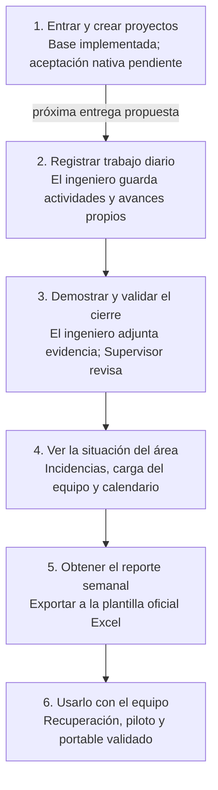

# Plan maestro de EasyFAB

Corte: 2026-10-29 · Responsable de producto: Alan.

Este documento es la única fuente del orden de construcción, alcance de las seis
entregas, criterios de aceptación y decisiones pendientes. El diagrama resume las
mismas seis entregas de la tabla; no es otro plan. Las fichas describen funciones,
los contratos definen datos y la evidencia acredita resultados, sin otra secuencia.

## Cómo construiremos EasyFAB

Construiremos el recorrido de trabajo de FAB por partes utilizables. Cada entrega
se conecta a la aplicación existente y se prueba antes de ampliar el recorrido.
Este es el orden de construcción propuesto; no son estados del sistema ni una
asignación de agentes. No implica ejecutar todas las entregas sin una solicitud.

Lectura textual: entrar y crear un proyecto → registrar el trabajo → demostrar y
validar su cierre → consultar el área → producir el reporte → validar el uso real.
Las flechas indican prioridad del recorrido principal; investigar la plantilla o
preparar recuperación puede avanzar antes si sus entradas están disponibles.
Respaldo y manejo de errores se incorporan con cada escritura, no hasta el piloto.

| Entrega | Qué podrá hacer la persona | Cómo sabremos que funciona | Decisiones aplicables |
|---|---|---|---|
| 1. Base disponible | Admin administra usuarios; Supervisor registra proyectos; Admin consulta. Cada usuario entra con su cuenta y carpeta validada. | Ver evidencia por alcance más abajo; completar comprobaciones nativas pendientes. No se declara lista toda la base. | Validación nativa de la base; ver evidencia |
| 2. Trabajo diario | El ingeniero abre un proyecto autorizado, registra una actividad y actualiza su avance. | Guarda, cierra y vuelve a entrar: conserva la actividad. Otra cuenta no puede modificarla. El avance no concede cierre aprobado. | Consulta/asignación y contrato de actividad por concretar |
| 3. Cierre verificable | El ingeniero entrega evidencia y solicita revisión; Supervisor acepta o devuelve para corrección. | La evidencia se recupera; la decisión corresponde a esa revisión. Una solicitud a 100% no se convierte por sí sola en aprobación. | D02/D03 |
| 4. Panorama del área | Se consultan incidencias, avances y capacidad del equipo en calendario. | Los totales coinciden con registros sintéticos conocidos; falta de información se muestra explícitamente. | D01/D05 |
| 5. Reporte semanal | Supervisor/Admin obtiene el reporte del periodo en el Excel oficial, según permisos definidos. | El archivo conserva plantilla, valores y presentación acordados y coincide con los datos del periodo. | D06 |
| 6. Uso validado | El equipo usa el portable y se comprueba recuperación y operación en condiciones reales. | Piloto de roles y dos equipos, recuperación y distribución con evidencia. Publicar requiere autorización concreta. | D04 y autorización de publicación |

**Siguiente entrega propuesta: trabajo diario de un ingeniero en un proyecto.**
Antes de implementarla se concreta quién ve qué proyectos, cómo se vincula una
actividad al proyecto y qué datos guarda el avance en la partición del usuario.
Se define el contrato, se conecta guardado y lectura, se incorpora la pantalla y
se prueba el recorrido completo. Las políticas de adjuntos y aprobación se
resuelven antes de añadir esas funciones en la entrega siguiente.

Ejemplo ilustrativo: Supervisor crea «Mejora de estación» → el ingeniero autorizado
registra «Preparar instrucción» y su avance → adjunta la evidencia cuando esa
función esté disponible → Supervisor valida el cierre → el resultado aparece en
las vistas y el reporte cuando se implementen. No son funciones ya entregadas.

## Cómo se construye cada entrega

Las pruebas se incorporan al implementar; la comprobación del recorrido confirma
que las piezas funcionan juntas. Todos los módulos usan el mismo espacio activo.
Los ingenieros escriben su partición; Supervisor registra proyectos y valida
cierres; Admin administra usuarios y consulta. Rust aplica permisos y persistencia;
React permite capturar y consultar. Se entrega una función utilizable por vez.

## Referencias para implementar

Este documento es la entrada al trabajo vigente. Elegir una historia solicitada,
consultar su ficha y leer únicamente sus contratos, implementación y evidencia.
No iniciar automáticamente el backlog completo.

| Pregunta | Fuente única | Regla |
|---|---|---|
| ¿Qué límites debe respetar el agente? | [AGENTS.md](../../AGENTS.md) | Invariantes y método de trabajo. |
| ¿Qué funcionalidad y permisos se esperan? | [Catálogo funcional](catalogo-modulos.md) | Fichas por superficie; la matriz de capacidades enlaza cobertura. |
| ¿Qué datos se permiten? | [Contratos v1](../../contracts/v1/) | Autoridad estructural; Rust aplica reglas y RBAC. |
| ¿Qué se construye, en qué orden y qué falta decidir? | Este plan: seis entregas y decisiones al final | Única planificación activa. |
| ¿Cómo ejecutar y cerrar una historia? | [Contrato de trabajo](planning/mission-contract.md) | Flujo breve, dependencias aplicables y verificación. |
| ¿Qué se comprobó realmente? | [Evidencia](execution/) | Resultados por alcance, fecha y límites; prevalecen sobre resúmenes antiguos. |

Una propuesta o documento completo no acredita implementación. Ante contradicción,
comparar el alcance y la fecha con la instrucción vigente de Alan; actualizar la
fuente correspondiente y enlazarla, sin inventar permisos ni declarar aceptación.
Si el comportamiento difiere del contrato, registrar deriva y corregirla; el código
no redefine por sí solo el contrato.

## Estrategia vigente

Entregar recorridos verticales pequeños con backend, UI y pruebas cuando apliquen.
Las seis entregas anteriores organizan el producto; cada una se implementa mediante
historias pequeñas con aceptación verificable.
Una historia usa solo las decisiones y contratos que consume. Recuperación D04
completo o el módulo de incidencias no son requisitos universales para cualquier cambio.
La dependencia técnica concreta debe quedar citada en la historia.

Integrar cada historia en la aplicación para poder revisarla. La entrega 6 comprueba
el recorrido completo y las condiciones del piloto. Serializar las ediciones de archivos compartidos
durante la integración, sin encadenar módulos completos por ese motivo.
El modo normal es secuencial. Si la tarea justifica especialistas concurrentes,
crear un DAG acotado con escrituras disjuntas y una sola evaluación de su DoD.
El cierre de esa historia no equivale a aceptar ni publicar todo EasyFAB.

## Base y siguiente selección

- Acceso y directorio: [recorrido y límites de aceptación](execution/f01/acceptance.md).
  Espacio configurable: [arquitectura vigente](../architecture/espacio-de-trabajo.md).
- Carpetas personales: [aceptación de carpetas](execution/f02/acceptance.md), layout decidido por manifiesto.
- Proyectos: [aceptación de proyectos](execution/f04/acceptance.md) y [flujo confirmado](execution/f04/flujo-confirmado.md).
  Admin administra cuentas y consulta; el único Supervisor activo registra;
  cada ingeniero escribe su partición. Avances y validación de cierre siguen pendientes.
- Navegación: [aceptación](execution/navigation-acceptance.md) y
  [estándar](../architecture/navegacion.md).
- Preferencias: [contrato y límites](execution/preferences-contract-acceptance.md),
  [política](../architecture/preferencias.md); persistencia y UI pendientes.
- Evidencias: [propuesta D03](execution/f01/propuesta-d03.md), todavía sin aceptación
  completa; no inferir aprobación de políticas de adjuntos.

La prioridad propuesta es la entrega 2, trabajo diario; la solicitud vigente define
la historia que se ejecuta. Las decisiones de otras entregas no son barreras globales. Para avances, resolver contratos de actividad y
escritura propietaria; para cierre, D02; para incidencias compartidas, D01;
para capacidad, D05; para exportación oficial, D06. D04 mantiene su alcance de
confianza y recuperación. La publicación requiere autorización concreta de destino,
versión y respaldo; esta revisión documental no publica ni migra datos.

## Criterios completos por entrega

La tabla anterior resume el resultado visible. Los criterios siguientes desarrollan
esas mismas entregas; no forman otra cola ni repiten estados de ejecución.

### Controles comunes

Revalidar código, contratos y evidencia del alcance; distinguir pruebas simuladas
de validación nativa. Resolver decisiones antes de sus consumidores, versionar
contratos y autorizar cualquier cambio de invariante. Incorporar pruebas y manejo
de errores desde cada implementación. Estado y resultados se acreditan en la
evidencia enlazada, sin mantener otro porcentaje o estado paralelo.

### 1. Base disponible

- **Carpetas y migración:** Validar el subalcance de layout ya implementado: cambio explícito reversible e idempotente, credenciales preservadas y una sola fuente activa. Las políticas de adjuntos pendientes de D03 pertenecen a la entrega 3.
- **Proyectos y catálogos:** RBAC real, asignaciones válidas, fechas, líneas, máquinas, fallas y referencias consistentes.

### 2. Trabajo diario

- **Actividades e hitos:** Escritura por sesión propietaria; hitos 0/25/50/75; 100 solicitado no equivale a aprobado.
- **Vista Engineer:** Proyectos autorizados, captura diaria e hitos; objetivo de captura diaria <60 s medido en piloto. Adjuntos se añaden en la entrega 3 e incidencias en la 4, sin bloquear este primer recorrido.

### 3. Cierre verificable

- **Evidencias:** Adjuntos múltiples con ID/revisión, límites acordados, referencias relativas y rechazo de rutas fuera del espacio; recuperación de copia interrumpida.
- **Aprobación y retrabajo:** D02 resuelta para la historia; autoridad del único Supervisor activo separada del perfil del ingeniero y ligada a revisión/evidencia; rechazo, reapertura e historial. Admin consulta, sin aprobación por rol.

### 4. Panorama del área

- **Incidencias de piso:** Resolver el protocolo pendiente de D01 para este alcance; append-only, deduplicación, correcciones como eventos, horas no negativas y scrap entero no negativo; prueba de reconexión y objetivo de captura <30 s medido en piloto.
- **Lecturas y métricas:** D05 aprobada; calendario, esfuerzo, capacidad neta, pesos y línea base explícitos; avance declarado/aprobado y datos faltantes diferenciados.
- **Vistas por rol:** Supervisor registra/asigna proyectos y aprueba o rechaza cierres; Admin administra usuarios/catálogos y consulta. Ambos consultan desviaciones según contrato; estados vacíos y errores accesibles. No conceder aprobación ni alta de proyectos a Admin.
- **Gantt y capacidad:** Ventana 21 días W-1/W0/W+1, zona America/Mexico_City; calendario FAB confirmado y capacidad basada en esfuerzo, no conteo de tareas.

### 5. Reporte semanal

- **Plantilla oficial Excel:** D06: Alan selecciona versión oficial; inspeccionar hojas, tablas, fórmulas, estilos e impresión y fijar fixture autorizado.
- **Exportación KMX-FW:** Snapshot consistente, plantilla oficial preservada y comparación de valores, tablas, fórmulas e impresión; salida en exports del espacio activo.

### 6. Uso validado

- **Confianza, recuperación y preferencias:** D04 aprobada; recuperación del único Admin, provisión de equipos y rotación; llave siempre local. Contraseña de 8 caracteres, temporal de 24 h y cambio obligatorio. Implementar preferencias locales por espacio/usuario, UI y pruebas; reset no modifica referencia, llave ni permisos.
- **Resiliencia y respaldo:** Respaldo de datos/evidencias/manifest sin master.key; restauración validada, compatibilidad de versiones, disco lleno y JSON inválido sin reinicializar datos.
- **Integración completa:** Proyecto → actividad → evidencia → aprobación → reporte, roles reales y sesiones restringidas probados en backend y UI.
- **Piloto y aceptación:** Preparar portable de piloto con hash antes de pruebas nativas. Pruebas sintéticas aisladas, roles, dos equipos, desconexión/reconexión, ausencia de pérdida/duplicación, tiempos de captura y evidencia nativa separada de mocks.
- **Candidato portable:** Build reproducible, hash, documentos/contratos, compatibilidad y rollback; portable único sin Node/Rust ni instalador obligatorio.
- **Publicación controlada:** Aprobación explícita futura, raíz resuelta y validada, backup, aceptación FAB y evidencia de publicación/rollback; sin migración implícita.

Preferencias personales son una historia de Configuración dentro de esta entrega.
No bloquean trabajo diario, evidencia ni reportes. Recuperación y respaldo se
preparan desde las escrituras que los necesitan; el piloto comprueba su conjunto.

## Decisiones pendientes

Abiertas para su alcance restante. Los subalcances confirmados no se reabren ni
se consideran aceptación de todo el tema. Cada decisión bloquea solo su consumidor.

| ID | Tema / responsable | Qué falta resolver o comprobar |
|---|---|---|
| D01 | Concurrencia OneDrive · Arquitectura + Alan | Confirmado para proyectos: único Supervisor activo escritor, Admin gestiona cuentas y consulta; una sesión por cuenta. Sigue pendiente protocolo verificable para incidencias compartidas. Append-only y rename local no garantizan convergencia ni exclusión distribuida. |
| D02 | Autoridad de aprobación · Supervisor + Arquitectura | Elegir registro autoritativo separado del JSON propiedad del ingeniero, unido a revisión y huella de evidencias. Un booleano escrito por el ingeniero no concede aprobación. |
| D03 | Carpetas y evidencias · Arquitectura | Layout 2 y selección única por manifiesto implementados en PLAN-013; layout 1 se conserva hasta mantenimiento explícito. Siguen pendientes aceptación completa, contrato operativo de adjuntos, tipos/tamaños/retención y recuperación. Ver execution/f02/acceptance.md y execution/f01/propuesta-d03.md. |
| D04 | Confianza y recuperación  | Definir custodio, provisión, rotación y recuperación del único Admin. HMAC compartido con un verificador permite firmar; no sincronizar master.key ni prometer revocación instantánea sin conexión. Otro esquema criptográfico requiere cambio explícito de invariante. |
| D05 | Reglas FAB · Supervisor | Confirmar calendario, semanas, turnos, esfuerzo, capacidad, pesos, unidades y línea base para desviaciones. Datos insuficientes se muestran como desconocidos. |
| D06 | Excel oficial ·  Supervisor | Seleccionar e inspeccionar plantilla oficial EN o EN-R2; el sufijo R2 no acredita autoridad. Las hojas/tablas del brief siguen por verificar. |

## Revisión del método

Diagnóstico, sustituciones de estados y riesgos: [revisión de simplificación](planning/reviews/workflow-simplification.md).
