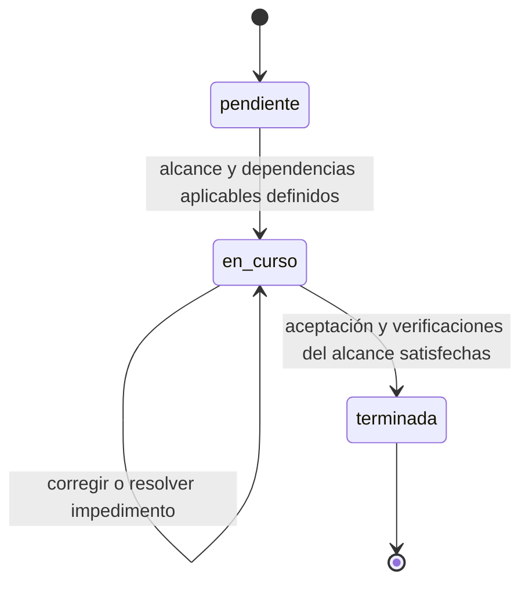

# Contrato de trabajo por historia

Política vigente desde 2026-10-29. Sustituye la programación global del plan de
2026-10-28. Entrada y mapa de autoridad: [plan maestro](../plan-maestro.md).

## Flujo mínimo

1. Delimitar resultado, aceptación, contratos y archivos afectados. Consultar la
   ficha existente; ampliarla solo si cambia la superficie o su responsabilidad.
2. Implementar la historia con pruebas relevantes. Resolver únicamente sus
   dependencias reales. Un bloqueo detiene el alcance afectado; avanzar lo independiente.
3. Verificar y entregar resultado, evidencia, límites y siguiente acción pendiente.
   Si falla una comprobación, corregir dentro de la misma historia; no abrir otra
   fase administrativa ni repetir una comprobación aprobada sin motivo nuevo.

DoR y DoD son criterios de entrada y salida, no aprobaciones manuales adicionales.
Para cambios rutinarios basta el alcance del chat y su resultado. Guardar una ficha
persistente si el trabajo cruza conversaciones, necesita handoff o deja bloqueos.
Reutilizar la ficha/evidencia existente: objetivo, alcance, aceptación, situación,
impedimento concreto si existe, resultados y próximo paso. No duplicarla en STATUS.

## Situación de una historia

Usar tres valores: `pendiente`, `en_curso`, `terminada`. Un impedimento es un campo
con causa, responsable y acción de desbloqueo; no otro estado. Una entrega parcial
se describe en evidencia y conserva pendientes sus criterios no satisfechos.
`Terminada` requiere cumplir el DoD de ese alcance; no acredita toda la entrega de producto.
Un fallo de pruebas conserva `en_curso`; nueva solicitud tras un cierre abre una
historia vinculada y conserva intacta la evidencia anterior.

Estos estados describen trabajo del agente. Los estados de acceso, actividad,
aprobación o UI pertenecen al producto y se rigen por sus contratos; no se reducen
por esta simplificación. Las entregas del plan maestro no son estados de esta FSM.

## Dependencias y concurrencia

Cada dependencia debe identificar el contrato, resultado o decisión consumida.
D01–D06, definidas en el plan maestro, bloquean únicamente sus consumidores.
No eludir RBAC, confianza, integridad ni decisiones necesarias para la historia.
Compartir lib.rs, Cargo.toml o App.tsx exige serializar esas ediciones, no esperar
la terminación de todos los módulos anteriores.

El modo secuencial no requiere scheduler, contratos JSON, épocas, hashes de toda
la documentación ni presupuestos artificiales de tokens/turnos. Guardar checkpoint
cuando haya interrupción, handoff o riesgo real de perder contexto: referencias,
decisiones, verificaciones y próximo paso; sin copiar logs ni código completo.

Para trabajo concurrente justificado, aplicar captis-dag-orchestration: grafo
acíclico, escrituras disjuntas, interfaces y artefactos por referencia, salidas propias
y convergencia en una evaluación de DoD del alcance. Emitir `.strategy.json` solo
si lo consume un ejecutor o se solicita; validarlo antes de ejecutarlo. Este
contrato no programa agentes ni autoriza publicación automáticamente.

## Verificación y cierre

Aplicar [testing.md](../../architecture/testing.md). Ejecutar `npm test` y
`scripts/verify_contracts.ps1` antes del cierre; Gate 0 contiene suites que se
repiten con npm test. Se conservan ambos comandos exigidos actualmente; no añadir
otras repeticiones sin cambio, fallo o incertidumbre. Esta revisión no cambia CI.

Registrar comandos y resultados reales. Si falta una comprobación requerida,
la entrega queda pendiente de verificar y se informa la causa. Un mock IPC no
acredita RBAC Rust ni WebView. Piloto, concurrencia en dos equipos, Excel oficial
y publicación se exigen a las historias que entregan esas capacidades, no a toda
edición documental o de navegación. Usar datos sintéticos y temporales aislados.
La publicación corporativa conserva autorización explícita y destino validado.
