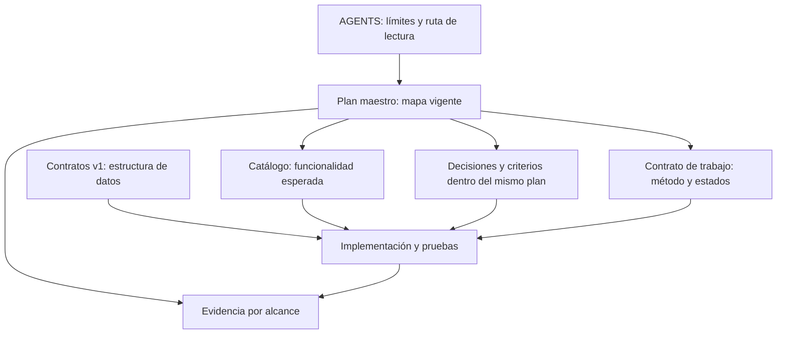

# Revisión de estrategia, estados y SSOT

Fecha: 2026-10-29. Alcance: instrucciones y planificación del repositorio.

Corrección tras revisión del usuario: la primera simplificación conservó una doble
planificación (seis entregas en Markdown y veinte paquetes en roadmap.json).
Se consolidaron criterios y D01–D06 en el plan maestro; roadmap.json se archivó.
Los hallazgos siguientes documentan la evolución, no otra autoridad de construcción.
Métodos: hss-simplifier, captis-dag-orchestration y captis-ssot-auditor.
Revisión estática de documentos, referencias, generador y fronteras de planificación;
no es auditoría de todos los contratos Rust/TypeScript ni medición de latencia del agente.
Los cambios previos del árbol de trabajo se conservaron como base.

## Diagnóstico con evidencia

| Hallazgo | Evidencia observada antes del cambio | Efecto | Remediación |
|---|---|---|---|
| Entrada repetida | AGENTS tenía dos secciones idénticas de navegación; plan maestro repetía catálogo/navegación | Lectura y mantenimiento duplicados | Una sección y mapa de fuentes por pregunta |
| Barrera global artificial | F01 exigía D01–D05; F04 dependía de F03, que agrupaba recuperación y preferencias | Una decisión ajena frena historias independientes; PLAN-013/014 necesitaban excepciones | Dependencias por contrato/decisión realmente consumida |
| Serialización por propiedad | mission-contract identificaba F07→F08 y F14→F15 como restricciones del registro Rust | Espera de módulos completos por editar archivos comunes | Serializar integración de archivos, no capacidades completas |
| FSM mezcla topología y ciclo de vida | easyfab-fsm contiene 20 nodos LE dentro de Running, además de fases de scheduler | Dependencias representadas como transiciones; sugiere ejecutor obligatorio | Tres situaciones de historia; DAG solo para trabajo concurrente justificado |
| Cierre desproporcionado | CE exigía piloto, Excel oficial y publicación tras todos los terminales | Confunde terminar una historia con entregar todo el sistema | DoD del alcance; aceptación global conserva sus comprobaciones |
| Fuente regeneradora obsoleta | build_plan.py contenía ROWS/DECISIONS duplicados y sobrescribía plan, roadmap, estrategia y autorización | Reejecutarlo perdía avances de layouts, decisiones y navegación; restauraba textos antiguos | Generador retirado a texto histórico; catálogo manual único |
| Autoridad de aprobación contradictoria | F07 decía Supervisor/Admin; AGENTS y catálogo reservan cierre al Supervisor | Plan podría inducir ampliación de RBAC | Criterio activo F07 corregido; D02 sigue pendiente para registro de aprobación |
| Estado documental atrasado | roadmap mantenía D01/D03 genéricas; STATUS tenía PLAN-001 in_progress y planes de portable posteriores completos | Parece que hay que reiniciar trabajo realizado | Decisiones reconocen subalcances confirmados; índice explícitamente histórico |
| Métricas de pruebas históricas | plan e informe conservaban 21 Rust/4 frontend; STATUS registra suites posteriores | Confunde evidencia pasada con validación actual | Resultado por fecha y alcance; sin contador global copiado |

No se atribuyen ahorros de tiempo ni tokens sin medición. El diagnóstico demuestra
fricción documental y bloqueos prescriptivos, no causalidad cuantificada de latencia.

## Estados y controles: qué se conserva

| Elemento anterior | Tratamiento | Razón |
|---|---|---|
| Draft, Validated, Scheduling | Absorbidos por delimitación y criterio de entrada | Sin ejecutor activo no necesitan persistencia independiente |
| Running | en_curso | Trabajo observable de una historia |
| Evaluating y subestados de CE | Comprobaciones dentro de en_curso | Verificar es una acción con resultados, no otra cola |
| Approved | terminada | Solo con DoD del alcance satisfecho |
| Blocked | Impedimento con causa, responsable y acción | Conserva información sin otra máquina paralela |
| Exhausted, épocas y reintentos numéricos | Fuera del flujo diario | Requieren ejecutor/presupuesto real; no se aplican como límites inventados al chat |
| previsto/listo/en desarrollo/implementado/validado de ficha | Situación de historia + evidencia independiente | Implementación y prueba nativa son dimensiones diferentes |
| Estados de acceso, actividad y aprobación | Conservados bajo sus contratos | Son lógica de producto, fuera del alcance de esta reducción |
| DoR, DoD, Gate 0 y RBAC | Conservados | Protegen aceptación, integridad y permisos |

La FSM normativa está una sola vez en [mission-contract](../mission-contract.md).
Las tres situaciones no obligan a crear registros para tareas breves. Cancelación
explícita se registra como decisión del usuario y motivo, sin declararla terminada
ni introducir ahora otra taxonomía automatizada.

## SSOT y radio de impacto

El diagrama muestra referencias, no una jerarquía que permita a evidencia o a un
plan anular contratos. El código debe ajustarse al contrato o tramitar su cambio.
Los documentos de arquitectura detallan las invariantes de AGENTS; si divergen,
se registra la discrepancia y se resuelve en su autoridad, sin elegir por conveniencia.
Los snapshots de estrategia, FSM, autorización, informe y revisiones antiguas se
archivaron en docs/archive/plans/PLAN_010_SUPERSEDED. Quedan fuera de la lectura
base y del mapa de fuentes vigentes; solo sirven para investigación histórica.

## Impacto verificable y límites

- Dos secciones idénticas de navegación en AGENTS pasan a una.
- Se retira de la entrada de AGENTS el árbol de archivos que repetía el repositorio.
- El DAG histórico de 20 nodos y 65 aristas deja de ser prerrequisito de cada historia.
- Una política activa de ejecución; tres situaciones de historia, con evidencia
  e impedimentos separados. No hay migración de enums del producto.
- Un generador que sobrescribía cuatro documentos pasa a texto histórico.
- DoD, decisiones y entregables dejan de copiarse en tablas del plan maestro;
  el plan maestro reúne entregas y decisiones; los documentos de evidencia mantienen sus límites.
- Se conserva la repetición exigida actualmente entre npm test y Gate 0. Optimizar
  CI exigiría otro cambio con pruebas; no se afirma haber eliminado ese costo.

Migración aplicada en orden: mapear evidencia existente, delimitar autoridades,
sustituir política activa, retirar regeneración obsoleta y verificar referencias/suites.
No se modificaron datos corporativos ni se ejecutaron entregables FAB.
Rollback: revertir solo los cambios de esta revisión documental y devolver el texto
histórico del generador a su ruta anterior si se decide recuperarlo; antes habría
que reconciliar sus datos obsoletos. No revertir el árbol completo: había cambios
previos ajenos a esta revisión.

Pendientes de producto conservados: D02, recuperación D04, reglas D05, plantilla
D06, políticas de adjuntos y concurrencia de incidencias. No hay declaración de
paridad total del repositorio, aceptación nativa nueva ni publicación autorizada.

## Verificación de esta revisión

2026-10-29: npm test aprobado (48 casos de contrato de preferencias, 30 pruebas
frontend y 29 Rust). Gate 0 ejecutado con PowerShell 7: contratos, TypeScript,
cargo check, suites y pruebas aisladas de cambio/rollback de layout aprobados.
Enlaces locales de los seis documentos revisados y parseo de roadmap JSON
aprobados; git diff --check de archivos seguidos modificados por esta revisión
sin errores. No se ejecutó validación nativa nueva. Advertencias de caché Cargo
por hard links no impidieron la aprobación.

## Consolidación final de la construcción

Causa adicional: una presentación visual de seis entregas convivía con veinte
paquetes técnicos le_fxx en un JSON sin consumidor automatizado encontrado.
Cambiarles la descripción no eliminaba las dos descomposiciones mantenidas a mano.
Ahora el plan maestro contiene el único orden, alcance y aceptación, más las seis
decisiones. El método de historia no repite el backlog; las fichas describen
funciones y los documentos de ejecución conservan resultados fechados.
Se preservaron los criterios de los veinte paquetes: dos controles comunes y
los dieciocho restantes agrupados en las mismas seis entregas del plan.
No se creó otro generador, índice de prioridades ni archivo de estados paralelo.

Verificación de la consolidación: enlaces activos y seis entregas/seis decisiones
comprobados; diff --check sin errores. npm test aprobó contratos (48 casos) y
frontend (30 pruebas), pero se interrumpió antes de completar Rust. La ejecución
posterior completa de Gate 0 terminó con código 0: contratos, TypeScript, cargo
check, 30 frontend, 29 Rust y cambio/rollback aislado aprobados. No se atribuye
aprobación completa al primer npm test interrumpido ni nueva validación nativa.
